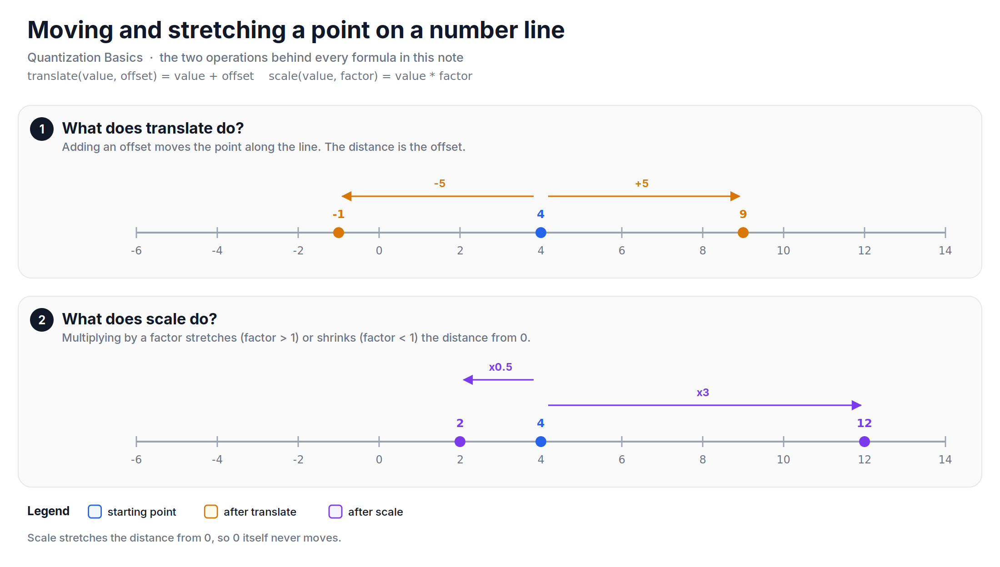
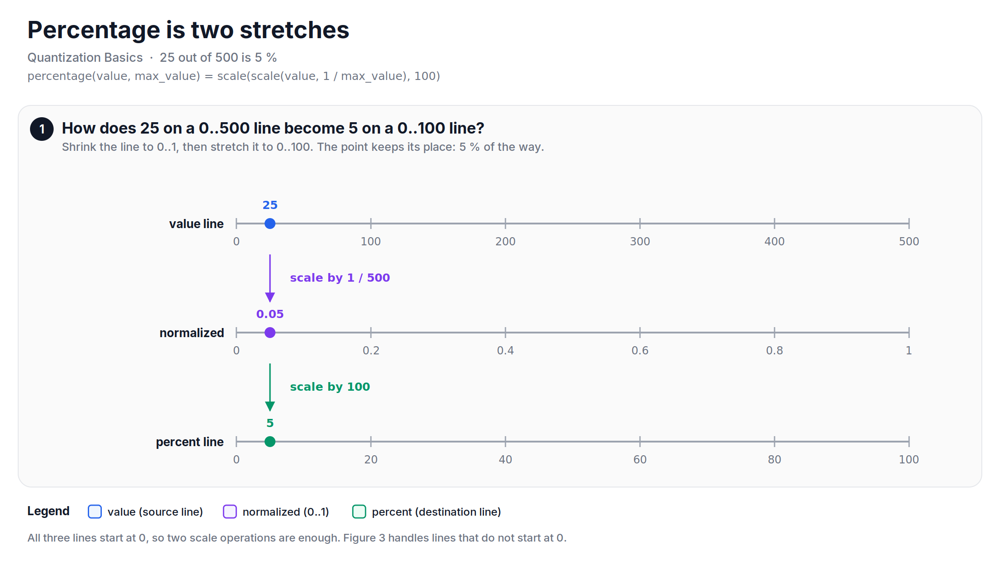
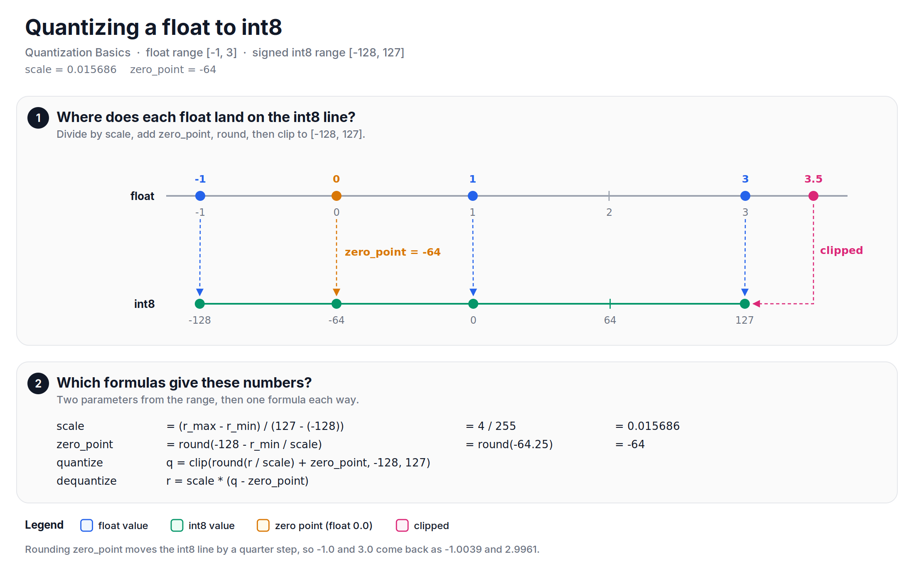

Quantization is just moving a point from one number line to another. A few years ago, I wrote a note on [Stack Overflow][so-original] about the quantization formula, and this note is a cleaned-up version of it. The old one had a few gaps in the code and in the formula. This one refines them, and every number here comes from a script that you can run.

Quantization means mapping values from a large set (all the floats) to a small set (the 256 integers of int8). If we think of each set as a number line, quantization is just moving a point from one number line to another. So, before diving into the formula, let's look at how we move and stretch a point on a number line.

## Moving and stretching a point
There are two operations that we need: translate and scale.

Translate moves a point by an offset. It is an addition: `translate(4, 5)` is 9 and `translate(4, -5)` is -1.

Scale stretches the distance of a point from 0 by a factor. It is a multiplication: `scale(4, 3)` is 12 and `scale(4, 0.5)` is 2. A factor bigger than 1 stretches, and a factor smaller than 1 shrinks. Since scale works on the distance from 0, the point at 0 never moves.

*Figure: translate adds an offset and moves the point; scale multiplies and stretches the distance from 0.*

Every formula in this note is a chain of these two operations.

## Percentage is two stretches
We have all used the percentage formula:

$$
percentage(value, max\_value) = \frac{value}{max\_value} \times 100
$$

Let's say we have 25 out of 500. Dividing by 500 shrinks the 0..500 number line to a 0..1 number line, and 25 lands at 0.05. Multiplying by 100 stretches the 0..1 line to a 0..100 line, and 0.05 lands at 5. So, 25 is 5% of 500.

*Figure: percentage maps a point from a 0..500 line to a 0..100 line with two scale operations. The point stays 5% of the way along.*

It means that the percentage formula maps a point from one number line (0..500) to another (0..100). The first scale uses the length of the source line, and the second scale uses the length of the destination line. This works because both lines start at 0.

## Mapping a point between any two number lines
What if a line does not start at 0? Celsius to Fahrenheit is a good example: 0..100 °C maps to 32..212 °F. Two scale operations are not enough here, because scale never moves 0. We need a translate at each end:

1. Translate the point by `-src_min`, so that the source line starts at 0.
2. Scale by `1 / src_length`, so that the source line becomes 0..1.
3. Scale by `dst_length`, so that the line becomes as long as the destination line.
4. Translate by `dst_min`, so that the line starts where the destination line starts.

$$
mapped = \frac{value - src\_min}{src\_max - src\_min} \times (dst\_max - dst\_min) + dst\_min
$$

This is the min-max scaling formula. With it, 37 °C maps to 98.6 °F.

Now, let's use the formula for what we came for. Let's say our float values are in [-1, 3], and we want to map them to the int8 line [-128, 127]. Let's follow the point 1.0 through the four steps:

![Five number lines stacked. 1.0 on [-1, 3] becomes 2.0 on [0, 4], then 0.5 on [0, 1], then 127.5 on [0, 255], then -0.5 on [-128, 127]. The point stays halfway along each line.](https://raw.githubusercontent.com/mrtpk/kaizen/master/learnings/20261017_quantization_formula/resources/fig3_map_point.png)
*Figure: the four steps of the mapping. 1.0 is halfway along [-1, 3], so it lands halfway along [-128, 127], at -0.5.*

Notice that the point stays at the same fraction of each line. That is what mapping means. But -0.5 is not an integer, and the int8 line has only integer points. This is where the quantization formula comes in.

## The quantization formula
If we look at the four steps again, two numbers depend only on the two ranges and not on the value. So, we can compute them once:

+ `scale` is the float distance between two neighbouring integers. The int8 line has 256 integer points and 255 steps between them, so for a float range of [r_min, r_max]:

$$
scale = \frac{r\_max - r\_min}{127 - (-128)} = \frac{r\_max - r\_min}{255}
$$

+ `zero_point` is the integer that the float 0.0 maps to:

$$
zero\_point = round\left(-128 - \frac{r\_min}{scale}\right)
$$

With these two numbers, the four steps fold into one formula. We divide by `scale`, add `zero_point`, round to the nearest integer, and clip to the int8 range:

$$
q = clip\left(round\left(\frac{r}{scale}\right) + zero\_point, -128, 127\right)
$$

For our range [-1, 3], `scale` is 4 / 255 = 0.015686, and `zero_point` is round(-64.25) = -64. So, -1.0 maps to -128, 0.0 maps to -64, 1.0 maps to 0, and 3.0 maps to 127. A value outside the range, like 3.5, is clipped to 127.

*Figure: quantizing the float range [-1, 3] to int8. 0.0 lands exactly on the zero point; 3.5 is outside the range and is clipped.*

There are two details that are easy to miss:

+ **The float range must contain 0.0.** Before computing `scale`, we extend the range so that `r_min <= 0 <= r_max`. Then 0.0 maps exactly to `zero_point`, with no error. This matters a lot in a neural network, because zero padding and ReLU produce exact zeros all the time.
+ **`zero_point` must be an integer.** Rounding it from -64.25 to -64 shifts the int8 line by a quarter of a step. It means that the ends of the range come back slightly off: -1.0 comes back as -1.0039 and 3.0 as 2.9961.

## Going back to float
To go back, we run the same map in the other direction. We subtract `zero_point` and multiply by `scale`:

$$
r = scale \times (q - zero\_point)
$$

This is not a second formula. It is the inverse of the first one, and this is the form that the TensorFlow documentation and the [integer-arithmetic-only paper][jacob-2018] use to define a quantized value.

The trip to int8 and back is not free. Inside the range, rounding moves a value to the nearest integer point, so the error is at most half a step, `scale / 2` = 0.007843. For example, 1.0 comes back as 1.0039. Outside the range, clipping has no bound on the error: 3.5 comes back as 2.9961, an error of -0.5039. That is why choosing the float range (calibration) matters so much.

![Three panels. 1: a zoomed float line around 1.0 with the integer points q = -1, 0, 1; 1.0 rounds to q = 0, which is 1.0039. 2: 3.5 is outside the representable range and comes back as 2.9961. 3: the asymmetric range covers [-1, 3]; the symmetric range covers [-3, 3] and leaves [-3, -1] unused.](https://raw.githubusercontent.com/mrtpk/kaizen/master/learnings/20261017_quantization_formula/resources/fig5_round_trip.png)
*Figure: the round trip loses at most half a step inside the range; outside the range the error has no bound. Symmetric quantization wastes levels when the range is lopsided.*

What we derived is asymmetric quantization, because `zero_point` can be any integer. When `zero_point` is fixed at 0, it is called symmetric quantization. The range becomes $[-\max|r|, \max|r|]$ on the integer line -127..127, so that r and -r map to q and -q. For |r| <= 3, `scale` is 3 / 127 = 0.023622, and 1.0 maps to 42 and -1.0 to -42. Symmetric is simpler to compute with (no `zero_point` to subtract), and it is common for weights. But for our lopsided range [-1, 3], one third of the levels are spent on [-3, -1], where there are no values.

## Let's look at the code
Each function is checked against the numbers above.


import numpy as np

Q_MIN, Q_MAX = -128, 127

def map_point(value, src_min, src_max, dst_min, dst_max):
    value = value - src_min                  # move the source start to 0
    value = value / (src_max - src_min)      # shrink to 0..1
    value = value * (dst_max - dst_min)      # stretch to the destination length
    return value + dst_min                   # move 0 to the destination start

def quantization_params(r_min, r_max):
    r_min, r_max = min(r_min, 0.0), max(r_max, 0.0)   # 0.0 must be on the line
    if r_max == r_min:                                 # all zeros
        return 1.0, 0
    scale = (r_max - r_min) / (Q_MAX - Q_MIN)          # 255 steps
    zero_point = int(np.clip(np.round(Q_MIN - r_min / scale), Q_MIN, Q_MAX))
    return scale, zero_point

def quantize(r, scale, zero_point):
    q = np.round(r / scale) + zero_point
    return np.clip(q, Q_MIN, Q_MAX).astype(np.int8)

def dequantize(q, scale, zero_point):
    return (q.astype(np.int32) - zero_point) * scale   # widen first, int8 - zero_point can overflow

print("37 C in F. Is pass?", np.isclose(map_point(37, 0, 100, 32, 212), 98.6))  # True

scale, zero_point = quantization_params(-1.0, 3.0)    # 0.015686, -64
print("0.0 maps to zero_point. Is pass?", quantize(np.array([0.0]), scale, zero_point)[0] == zero_point)  # True

x = np.random.uniform(-1.0, 3.0, 100_000)
error = np.abs(dequantize(quantize(x, scale, zero_point), scale, zero_point) - x)
print("Round-trip error <= scale / 2. Is pass?", error.max() <= scale / 2 + 1e-9)  # True


The full script, with the percentage and symmetric examples, is available [here](https://github.com/mrtpk/kaizen/tree/master/learnings/20261017_quantization_formula). The figures are drawn by the scripts in the same folder.

So, in short: quantization is a map between two number lines. `scale` is the float length of one integer step, `zero_point` is where 0.0 lands, and the formula is just divide, add, round and clip. Going back is the same map in reverse, and it costs at most half a step of error inside the range.

The formula is the easy part, though. On real hardware, the multiplication by `scale` has to be done with integers only, and that is where the interesting decisions are. That is the topic of my next series, Int8 on Silicon.

**Reference:**
+ [Quantization and Training of Neural Networks for Efficient Integer-Arithmetic-Only Inference][jacob-2018]
+ [MinMaxScaler, scikit-learn][minmaxscaler]
+ [The original note on Stack Overflow (2023)][so-original]

[so-original]: https://stackoverflow.com/questions/76192466/a-beginners-guide-with-python-implementation-to-master-quantization-formula-in
[jacob-2018]: https://arxiv.org/abs/1712.05877
[minmaxscaler]: https://scikit-learn.org/stable/modules/generated/sklearn.preprocessing.MinMaxScaler.html
