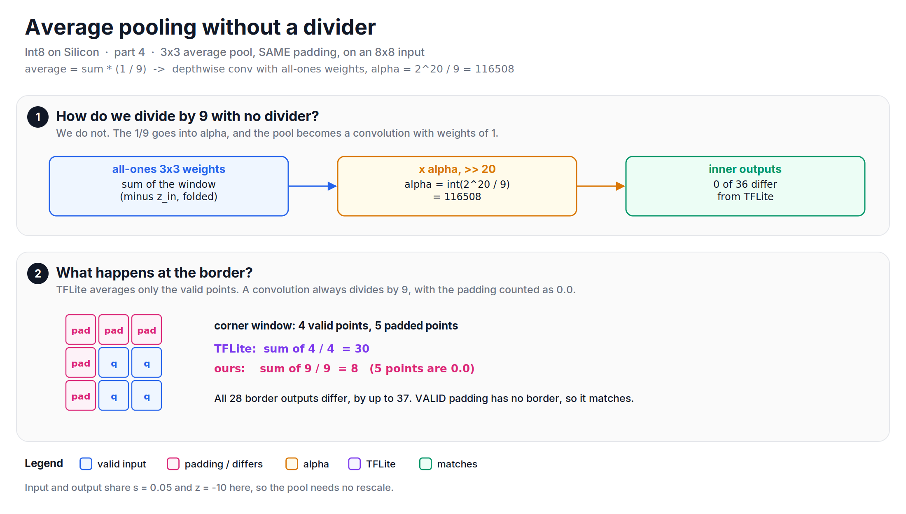
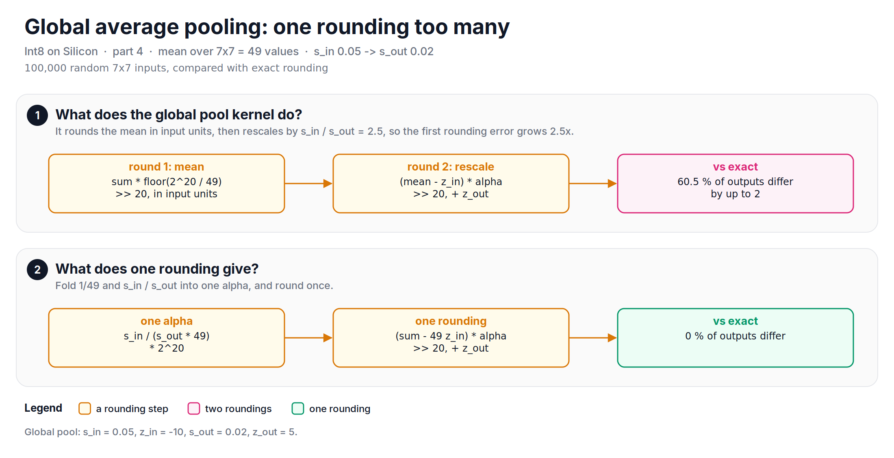

Average pooling, mean, sigmoid, softmax and resize all seem to need a divider or an exponential, and the hardware had neither a divider nor a floating-point unit. This note is about how we ran them anyway.

[Part 3][part3] showed how one post-processing unit (bias, multiply, shift, zero point, clip) runs add, multiply and the ReLU family. This part pushes the same unit further, and it is also the part where I found the most small gaps while writing the scripts.

## Average pooling is a convolution
An average is a sum divided by a count. Let's say a 3X3 average pool: the output is the sum of 9 values times $\frac{1}{9}$. We cannot divide, but we can multiply, and the unit already multiplies by `alpha`. So, the $\frac{1}{9}$ goes into `alpha`:

$$
\alpha = \frac{1}{9} \cdot \frac{s_{in}}{s_{out}} \cdot 2^{20} = 116508 \quad (\text{for } s_{in} = s_{out})
$$

And the sum? That is a depthwise convolution with all weights equal to 1. The reference model implemented every average pool as exactly that, and a mean over channels as a 1X1 convolution with all-ones weights and $\frac{1}{C}$ in `alpha`. No new hardware: the MAC array sums, the unit divides.

*Figure: three kinds of average, and how each runs without a divider.*

For a 3X3 pool on an 8X8 input, the 36 inner outputs match TFLite exactly. The border is another story.

*Figure: average pooling as a convolution is exact inside the image, but at the border it divides by 9 even when only 4 points are valid.*

With SAME padding, TFLite averages only the valid points: the corner window has 4 valid points, so TFLite divides by 4. A convolution cannot do that. It sums all 9 points, the 5 padded points count as 0.0 (they hold the input zero point, as in [part 2][part2]), and `alpha` divides by 9. At the corner, TFLite gives 30 and we give 8. All 28 border outputs differ, by up to 37. With VALID padding there is no border, and the convolution is exact. A per-position `alpha` at the border would fix it, but the unit had one `alpha` per channel.

## Global average pooling: one rounding too many
Global average pooling (the mean over the whole 7X7 map at the end of a classifier) had its own kernel. It did the mean in two steps:

1. Multiply the sum by $\lfloor 2^{20} / 49 \rfloor$ and shift by 20. This gives the mean in input units, rounded to an integer.
2. Rescale the mean to the output scale with a second `alpha`, and shift by 20 again.

That is two roundings, in a design whose whole point was one. The first rounding error is up to half an input step. The second step multiplies it by $s_{in} / s_{out}$. For $s_{in} = 0.05$ and $s_{out} = 0.02$, that is 2.5, so the first rounding becomes up to 1.25 output steps. Over 100,000 random inputs, 60% of the outputs differ from exact rounding, by up to 2. Folding $\frac{1}{49}$ and $\frac{s_{in}}{s_{out}}$ into one `alpha` with one rounding is exact for every input.

*Figure: global average pooling with two roundings, and the one-rounding version.*

## Non-linear functions are tables
What about sigmoid, tanh or hard-swish? There is no exp in the hardware. But an int8 input has only 256 possible values. It means that any function of one int8 input is a table of 256 int8 entries. The compiler computes the table once, in float, and the hardware does one table read per value. That is how the reference model ran sigmoid, tanh, hard-swish and rsqrt.

*Figure: one-input functions become 256-entry tables. Softmax needs a whole row, so it ran on the host.*

The difference here is one character. The tables were filled with `int(value)`, which truncates, instead of rounding. Only tanh used `round()`. For a sigmoid with input scale 0.08 and TFLite's sigmoid output scale of 1/256, 113 of the 256 entries are one step off the rounded value, always toward zero. A table costs the same whether it is rounded or not, so this one is free to fix.

## Softmax goes to the host
Softmax is different: each output depends on the whole row (the sum of exponentials), so it is not a table. The hardware did not support it, and it ran in float on the host. The result was cast back to int8 with the same `int()` truncation. Since the softmax output zero point is -128, most values are negative, and truncation moves them toward zero. 82% of the values come out one step off from rounding. In the script's random rows, the argmax stayed the same in more than 99% of them, and the argmax is what a classifier uses.

## Resize: weights that do not add up
Bilinear resize computes each output as a weighted sum of 4 neighbours. The 4 weights should add up to 1. In the reference model, the weights were computed in float, multiplied by $2^{10}$, and each was truncated on its own. For a 2X upscale, the weights are quarters, which are exact in 10 bits, and the result is identical to TFLite's integer resize. For 8X8 to 13X13, the truncated weights add up to 1021-1024 instead of 1024, and 26 of the 169 outputs differ from TFLite by 1. TFLite builds the four weights from integer coordinates, as $(1024 - f)$ and $f$, so the four products of the x and y weights always add up to exactly $1024 \times 1024 = 2^{20}$.

*Figure: one output point of the 8X8 to 13X13 resize. Truncating each weight on its own loses 3 of 1024.*

## Let's look at the code
The average pool border and the global pool, side by side:


import numpy as np

def round_shift(x, shift):
    a = np.abs(x)
    r = (a >> shift) + ((a >> (shift - 1)) & 1)
    return np.where(x < 0, -r, r)

rng = np.random.default_rng(0)
z, K = -10, 3
q = rng.integers(-128, 128, (8, 8))
alpha = int(2**20 / 9)                                   # 116508: the 1/9 is in alpha
p = np.pad(q, 1, constant_values=z)                      # padding holds the zero point
tfl, ours = np.zeros((8, 8), int), np.zeros((8, 8), int)
for y in range(8):
    for x in range(8):
        win = q[max(0, y - 1):y + 2, max(0, x - 1):x + 2]          # TFLite: valid points only
        acc, n = int(win.sum()), win.size
        tfl[y, x] = (acc + n // 2) // n if acc > 0 else -((-acc + n // 2) // n)
        ours[y, x] = round_shift(np.array(int((p[y:y + 3, x:x + 3] - z).sum()) * alpha), 20) + z
print("Inner outputs equal. Is pass?", np.array_equal(ours[1:-1, 1:-1], tfl[1:-1, 1:-1]))   # True
print("Border outputs equal. Is pass?", np.array_equal(ours, tfl))                          # False

# global average pool over 49 values, s_in 0.05 / z -10 -> s_out 0.02 / z 5
x = rng.integers(-128, 128, (100_000, 49))
sums = x.sum(axis=1)
mean_q = round_shift(sums * (2**20 // 49), 20)                                   # rounding 1
two = round_shift((mean_q + 10) * int(0.05 / 0.02 * 2**20), 20) + 5              # rounding 2
one = round_shift((sums + 490) * round(0.05 / (0.02 * 49) * 2**20), 20) + 5      # one rounding
v = 0.05 * (sums / 49 + 10) / 0.02
exact = np.sign(v) * np.floor(np.abs(v) + 0.5) + 5
print(f"Two roundings: {(two != exact).mean() * 100:.1f} % differ")             # 60.5 %
print(f"One rounding: {(one != exact).mean() * 100:.1f} % differ")              # 0.0 %


The full script, with the tables, softmax and resize, is available [here](https://github.com/mrtpk/kaizen/tree/master/learnings/20261029_int8_on_silicon_4).

So, in short: with no divider, a division becomes a multiply by a constant in `alpha`, an average becomes a convolution with all-ones weights, and a non-linear function becomes a 256-entry table. Softmax stayed on the host. The ideas held up, but the scripts found four small gaps: the pool border, a second rounding in global pooling, truncated tables, and resize weights that do not add up.

In part 5, we will look at the compiler frontend that turned a TFLite model into these layers, and at how we checked every layer against the hardware and against TFLite.

**Reference:**
+ [Int8 on Silicon - Part 2: Making zero points disappear][part2]
+ [Int8 on Silicon - Part 3: One unit, many operations][part3]
+ [TFLite reference int8 pooling (v2.16.1)][tflite-pool]
+ [TFLite reference resize bilinear (v2.16.1)][tflite-resize]

[part2]: https://www.thomaspaul.dev/2026/10/202610int8-on-silicon-2-zero-points.html
[part3]: https://www.thomaspaul.dev/2026/10/202610int8-on-silicon-3-one-unit-many-operations.html
[tflite-pool]: https://github.com/tensorflow/tensorflow/blob/v2.16.1/tensorflow/lite/kernels/internal/reference/integer_ops/pooling.h
[tflite-resize]: https://github.com/tensorflow/tensorflow/blob/v2.16.1/tensorflow/lite/kernels/internal/reference/resize_bilinear.h
