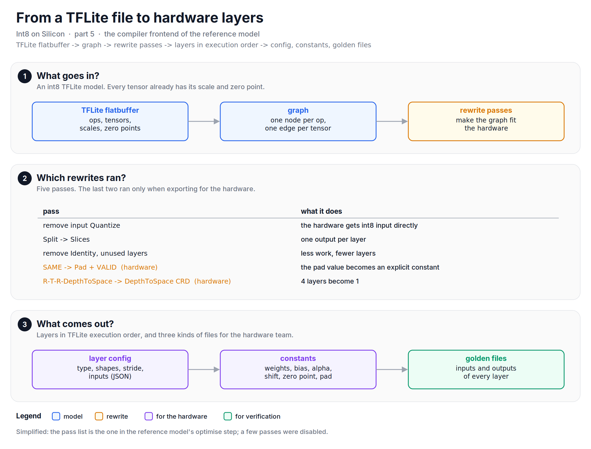
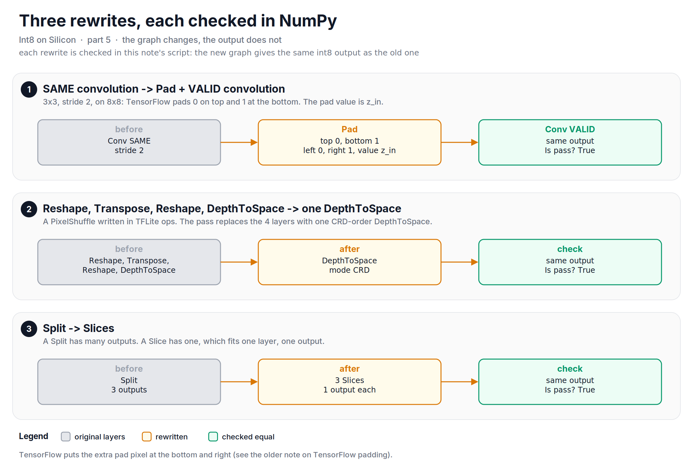

Arithmetic alone does not run a neural network. This note is about the software around the math: the compiler frontend that turned a TFLite model into hardware layers, and the files and checks that told us every layer was right.

Parts [1][part1] to [4][part4] were about arithmetic. But arithmetic alone does not run a model. Somebody has to read the model file, reshape the graph into what the hardware can run, decide what runs on the host, and write the constants. And somebody has to prove that the hardware does what the reference model says. In our team, the reference model did both.

## From a TFLite file to a graph
The input was an int8 TFLite model. That is a good starting point, because the quantization is already done: every tensor has its scale and zero point, every weight is already int8. The frontend read the flatbuffer (TFLite's file format) and built a graph with the networkx library: one node per operation, one edge per tensor. Model inputs got negative layer ids, and every other layer got an id in TFLite's execution order.

Then a list of rewrite passes changed the graph so that it fits the hardware:

+ **Remove the input Quantize.** The hardware gets int8 input directly, so the float-to-int8 step at the model input is not needed.
+ **Split becomes Slices.** A Split has several outputs. A Slice has one, which fits the "one layer, one output" model of the hardware.
+ **Remove Identity and unused layers.** Less work, fewer layers.
+ **SAME convolution becomes Pad + VALID convolution** (hardware export only). [Part 2][part2] showed why the pad value must be the input zero point. With an explicit Pad layer, that value is a visible constant, and the convolution has no border case.
+ **Reshape, Transpose, Reshape, DepthToSpace becomes one DepthToSpace** (hardware export only). This is how a PixelShuffle from PyTorch can look after conversion to TFLite. The pass recognizes the 4-layer pattern and replaces it with one DepthToSpace in the CRD order. (DepthToSpace can read the channels in two orders: TensorFlow uses DCR, depth-column-row, and PixelShuffle uses CRD, column-row-depth.)

*Figure: the frontend reads the TFLite graph, rewrites it for the hardware, and writes three kinds of files.*

Every rewrite must leave the output unchanged: the new graph and the old graph must give the same int8 output. The script of this note checks each rewrite that way in NumPy. For SAME padding, the split is easy to get wrong, because TensorFlow puts the extra pixel at the bottom and right. For a 3X3 convolution with stride 2 on an 8X8 input, the padding is 0 on top and 1 at the bottom, not 1 and 0. (I wrote about that rule in [an older note][tf-padding].)

*Figure: three rewrites. The graph changes, the int8 output does not.*

## The layers and what they wrote
After the passes, each node became a layer object. The reference model implemented 32 layer types, from convolution and dense to resize, split, strided slice, rsqrt, hard-swish and squared difference. The heavy ones (convolution, pooling, add, multiply, PReLU, softmax, resize) were in C++, called from Python through Boost.Python. I wrote about that interface in [another older note][boost-note]. The light ones (reshape, transpose, concat, slicing) were NumPy.

For the hardware, each layer wrote three things:

1. **A layer config**: the operation type, the input and output shapes, kernel size, stride, padding type, and the ids of the layers that feed it. One JSON entry per layer.
2. **The constants**: the weights, and the post-processing constants from part 1: per-channel bias and `alpha`, the shift, the output zero point, the clip range, and the pad value.
3. **Golden files**: the input and the output of every layer, for verification.

![One panel with two cards. Left: a simplified JSON layer config for a 3x3 convolution: op, layer id 7, inputs [6], input rows and columns 56, 64 input and 128 output channels, kernel 3, stride 1, VALID padding, groups 1. Right: a constants file: pad value -64, output zero point -12, shift 20, clip -128 127, and per channel alpha 2416 and bias -24868.](https://raw.githubusercontent.com/mrtpk/kaizen/master/learnings/20261101_int8_on_silicon_5/resources/fig5_layer_config.png)
*Figure: one convolution layer as the hardware sees it, simplified. The config says what to run; the constants say how to finish it.*

The golden files were plain text, one value per line, as `channel index : value`, and the weights also in hex. Not compact, but a hardware engineer can open it, search for a channel, and compare by eye. The amount of output was a setting: none, the constants only, constants plus all inputs and outputs, or everything for one specific layer when we were chasing a bug. For convolutions, it also had two named accumulator dumps, before and after the zero-point correction, meant to split the "is the MAC wrong or is the correction wrong" question in two ([part 2][part2]).

*Figure: golden files are plain text, one value per line, and the amount of output is a setting.*

## What runs on the host
Not every operation ran on the accelerator. Softmax ran on the host ([part 4][part4]), and so did post-processing like box decoding and non-maximum suppression in detectors. So, the frontend also split a model into subgraphs: each subgraph runs entirely on the accelerator or entirely on the host.

The rule has two parts:

1. Cut every edge between a supported and an unsupported operation.
2. Also cut every edge that jumps over an unsupported operation in execution order.

The second rule is easy to forget. Let's say the order is conv1, conv2, argmax, conv3, add, softmax, where argmax and softmax run on the host, and add takes the outputs of conv3 and argmax.

With only the first rule, conv1, conv2, conv3 and add form one accelerator subgraph. But add needs argmax, which runs on the host after conv1. The accelerator cannot run that subgraph in one go.

With the second rule, the edge from conv2 to conv3 jumps over argmax and is cut. We get four subgraphs: {conv1, conv2} on the accelerator, {argmax} on the host, {conv3, add} on the accelerator, {softmax} on the host. The frontend wrote each subgraph with its input and output tensors to a JSON file. Figure 3 shows both versions side by side.

*Figure: partitioning between accelerator and host, and the verification loop around the reference model.*

## How we knew it was right
There were two targets, and it is important not to mix them up.

**The hardware: bit-exact.** The hardware team ran the same input with the same weights and constants on the FPGA and compared the output of every layer with the golden files. The target was zero difference. When a layer differed, the golden files narrowed it down: which layer, which channel, which position.

**TFLite: accuracy, not bits.** The reference model was not bit-exact with TFLite, by design ([part 1][part1]). So, against TFLite, we checked two things. First, layer by layer: a debugger ran the same input through the TFLite interpreter and through the reference model and compared each layer's output, to make sure that our version of each layer was right. Some layers matched with zero deviation, and the others differed by small amounts. Second, on full datasets: a suite per model family ran the same data through TFLite and through the reference model and compared the metric. That covered image classifiers (MobileNets, EfficientNet, ResNet-50), detectors (SSD, SSDLite, YOLO, MTCNN, RetinaFace), face recognition (ArcFace), video matting, super resolution and visual wake words. The accuracy was on par with TFLite.

Some of the same suites were also packaged (with PyInstaller) into standalone demo apps, with the pre- and post-processing in C, so that a demo did not need a Python setup.

## Let's look at the code
The partition rule and the SAME padding split:


import math
import numpy as np

# partition: (name, runs on the accelerator, inputs), in execution order
graph = [("conv1", True, []), ("conv2", True, ["conv1"]), ("argmax", False, ["conv1"]),
         ("conv3", True, ["conv2"]), ("add", True, ["conv3", "argmax"]), ("softmax", False, ["add"])]
order = [n for n, _, _ in graph]
sup = {n: s for n, s, _ in graph}
keep = []
for name, _, inputs in graph:
    for a in inputs:
        span = order[order.index(a):order.index(name) + 1]
        if sup[a] == sup[name] and all(sup[n] == sup[a] for n in span):   # both rules
            keep.append((a, name))
parent = {n: n for n in order}
def find(n):
    while parent[n] != n:
        n = parent[n]
    return n
for a, b in keep:
    parent[find(b)] = find(a)
groups = {}
for n in order:
    groups.setdefault(find(n), []).append(n)
print(list(groups.values()))   # [['conv1', 'conv2'], ['argmax'], ['conv3', 'add'], ['softmax']]
print("Four subgraphs. Is pass?", len(groups) == 4)   # True

# SAME padding: the extra pixel goes to the bottom / right
def same_pads(size, k, stride):
    total = max((math.ceil(size / stride) - 1) * stride + k - size, 0)
    return total // 2, total - total // 2
print("8x8, 3x3, stride 2. Is pass?", same_pads(8, 3, 2) == (0, 1))    # True


The full script, with every rewrite checked in NumPy, is available [here](https://github.com/mrtpk/kaizen/tree/master/learnings/20261101_int8_on_silicon_5).

So, in short: the frontend read an int8 TFLite model, rewrote the graph for the hardware, split it between accelerator and host, and wrote a config, the constants and golden files for every layer. The hardware had to match the golden files bit for bit. TFLite had to match in accuracy.

In part 6, the last one, I will collect what I would do differently, including the small gaps that the scripts of this series found.

**Reference:**
+ [Int8 on Silicon - Part 1: One multiply, one shift][part1]
+ [Int8 on Silicon - Part 2: Making zero points disappear][part2]
+ [Int8 on Silicon - Part 4: Operations without a divider][part4]
+ [TensorFlow's padding in convolution layer][tf-padding]
+ [Interfacing CPP and Python using Python Boost][boost-note]

[part1]: https://www.thomaspaul.dev/2026/10/202610int8-on-silicon-1-one-multiply-one-shift.html
[part2]: https://www.thomaspaul.dev/2026/10/202610int8-on-silicon-2-zero-points.html
[part4]: https://www.thomaspaul.dev/2026/10/202610int8-on-silicon-4-operations-without-a-divider.html
[tf-padding]: https://www.thomaspaul.dev/2021/08/202108Padding-in-TensorFlow.html
[boost-note]: https://www.thomaspaul.dev/2021/08/202108Interfacing-CPP-and-Python-using-Boost.html
