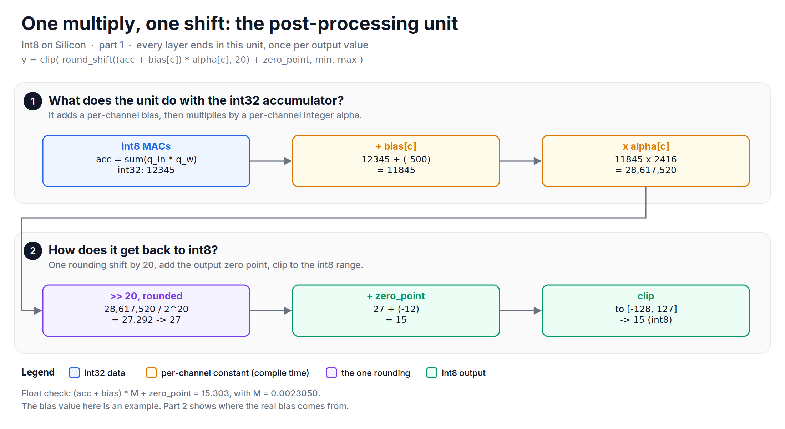
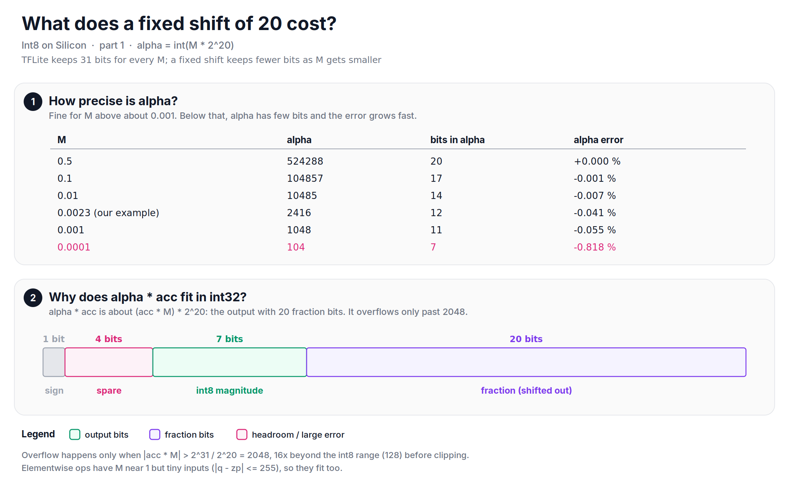

Lately, I have been going through my notes from an int8 accelerator project, and this series is about the integer math behind it. This first part is about the most important line of that math: how a layer goes from a 32-bit accumulator back to an 8-bit output with one multiply and one shift.

From 2020 to 2023, I worked at Roviero, a startup that built an int8 neural network accelerator for edge devices. I wrote its reference model: an inference engine, a compiler frontend and a bit-accurate simulator in Python and C++. The order of work is the interesting part. The hardware team gave me the constraints, I did the math in the reference model and tested it on real models, and then the hardware team implemented the same math in silicon. The reference model was bit-exact with the hardware. It was not bit-exact with TFLite, though some layers matched TFLite exactly, and the final accuracy was on par with TFLite. We were ahead of the game, but Roviero did not survive: the hardware was built for CNNs, just before LLMs changed what everyone needed. The math is still worth writing down.

The series:
1. One multiply, one shift (this note)
2. Making zero points disappear
3. One unit, many operations
4. Operations without a divider
5. The compiler frontend and how we verified it
6. What I would do differently

## Before diving in, where does the multiply come from?
In [Quantization Basics][quant-basics], we saw that a real value is $r = s(q - z)$, with a scale $s$ and a zero point $z$. Let's look at one output of a convolution. It is a sum of products of inputs and weights:

$$
r_{out} = \sum r_{in} \cdot r_{w} = s_{in} s_{w} \sum (q_{in} - z_{in})(q_{w} - z_{w})
$$

The sum is all integers, so the hardware computes it with int8 multiply-accumulates into an int32 accumulator. Let's call it `acc`. To get the int8 output, we divide by $s_{out}$ and add $z_{out}$:

$$
q_{out} = z_{out} + \frac{s_{in} s_{w}}{s_{out}} \cdot acc = z_{out} + M \cdot acc
$$

Everything here is an integer except $M$. For a typical layer, $M$ is a small real number, for example $M = 0.0235 \times 0.0041 / 0.0418 = 0.0023050$. The hardware has no floating point, so the whole question is: how do we multiply an integer by 0.0023050 with integers only?

## The hardware rules
The accelerator had an array of int8 multipliers with int32 accumulators. After the array, each output went through a small post-processing unit:

1. Add a per-channel bias (int32).
2. Multiply by a per-channel integer `alpha`.
3. Shift right, with rounding.
4. Add the output zero point.
5. Clip to the output range.

There was one more rule, and it shaped everything: **the shifter supported only a few shift amounts.** Each extra shift amount costs area and wiring. So, a different shift for every channel, which is what TFLite does, was not an option.

*Figure: one output through the post-processing unit. Every layer ends in this unit.*

## How does TFLite do it?
TFLite splits $M$ into a 31-bit mantissa and a power of two, $M = q_{31} \cdot 2^{-31} \cdot 2^{shift}$. For our $M$, that is `q31 = 1267200256` and `shift = -8`. At runtime it does two steps:

1. Multiply `acc` by `q31` in 64 bits and keep the high 32 bits, rounded. This is rounding number one.
2. Divide by $2^8$ with a rounding shift. This is rounding number two.

The 31-bit mantissa keeps $M$ very precise for any size of $M$. The price is a shifter that can shift by any amount, per channel, and two roundings. (TFLite also has a build flag, `TFLITE_SINGLE_ROUNDING`, that does it with one rounding. The default build uses two.)

## How did we do it?
We fixed the shift at 20 and moved all the precision into `alpha`:

$$
\alpha = M \cdot 2^{20}, \quad q_{out} = z_{out} + round\left(\frac{\alpha \cdot acc}{2^{20}}\right)
$$

`alpha` is computed once per channel at compile time. At runtime, there is one multiply and one rounding shift by 20. For our $M$, `alpha` is 2416. The rounding is "round half away from zero", and in hardware it is a shift, a mask and the sign:


def round_shift(x, shift):
    a = abs(x)
    r = (a >> shift) + ((a >> (shift - 1)) & 1)   # add 1 when the first dropped bit is 1
    return -r if x < 0 else r


Let's say `acc` is 12345. The exact value is $12345 \times 0.0023050 = 28.4555$. TFLite gives 28, and we give 28.

*Figure: the same multiply by M, done two ways. The results are never more than 1 apart.*

Over 200,000 random accumulators, our result differs from TFLite in 3.02% of the cases, and never by more than 1. It means that our outputs are not bit-exact with TFLite, but they are always a neighbour.

Here is the part that I only found while writing this note. When I compare both against exact rounding of `acc * M`, TFLite is off in 0.18% of the cases and we are off in 2.83%. But the gap is not from the single rounding. We computed `alpha` with `int()`, which truncates 2416.99 down to 2416. If we round `alpha` to 2417 instead, we are off from exact in only 0.02% of the cases, which is better than TFLite. One rounding was the right call. Truncating `alpha` was a one-line mistake.

## What does a fixed shift cost?
A fixed shift has two costs: precision and range.

**Precision.** With a 31-bit mantissa, TFLite keeps 31 bits of $M$ for any $M$. With a fixed shift of 20, `alpha` has fewer bits as $M$ gets smaller. For $M = 0.01$, `alpha` has 14 bits and an error of 0.007%. For our $M = 0.0023$, it has 12 bits and an error of 0.041%. For $M = 0.0001$, only 7 bits remain, and the error is 0.8%.

**Range.** The product `alpha * acc` must fit in int32. This looks risky, but it is not. `alpha * acc` is about $(acc \cdot M) \cdot 2^{20}$: the output value with 20 fraction bits. The output is an int8 value before the clip, so the product needs 1 sign bit, 7 bits for the int8 magnitude and 20 fraction bits. That is 28 bits, and 4 bits remain spare. The product overflows only when $|acc \cdot M| > 2^{31} / 2^{20} = 2048$, which is 16 times beyond the int8 range.

*Figure: a fixed shift of 20 loses precision for very small M, but the product always fits in int32 while the output is near the int8 range.*

So, why 20? It is the largest shift that leaves room for an int8 output and a few spare bits in a 32-bit product. The other operations used other shifts from the same short list (16 and 10), which we will meet in part 3.

## Did it matter?
Not for accuracy. We ran the same models through TFLite and through the reference model on full datasets, and the accuracy was on par. Layer by layer, the intermediate outputs of some layers matched TFLite with zero deviation, and the others differed by small amounts. In the simulation above, the difference is 1 in 3% of the values, and the next layer sees that as noise.

## Let's look at the code
Both methods side by side, checked against each other:


import math
import numpy as np

def quantize_multiplier(m):                  # TFLite: Q31 mantissa + shift
    q, shift = math.frexp(m)
    q31 = round(q * (1 << 31))
    if q31 == 1 << 31:
        q31, shift = q31 // 2, shift + 1
    return q31, shift

def high_mul(a, b):                          # rounding #1: high 32 bits of 2*a*b
    ab = a * b
    v = ab + ((1 << 30) if ab >= 0 else 1 - (1 << 30))
    return v // (1 << 31) if v >= 0 else -((-v) // (1 << 31))

def rounding_divide(x, e):                   # rounding #2: x / 2^e
    mask = (1 << e) - 1
    threshold = (mask >> 1) + (1 if x < 0 else 0)
    return (x >> e) + (1 if (x & mask) > threshold else 0)

def round_shift(x, shift):                   # ours: the only rounding
    a = abs(x)
    r = (a >> shift) + ((a >> (shift - 1)) & 1)
    return -r if x < 0 else r

M = float(np.float32(0.0235) * (np.float32(0.0041) / np.float32(0.0418)))
q31, shift = quantize_multiplier(M)         # 1267200256, -8
alpha = int(np.float32(M) * np.float32(1 << 20))   # 2416

accs = np.random.default_rng(0).integers(-60_000, 60_001, 200_000)
tflite = np.array([rounding_divide(high_mul(int(a), q31), -shift) for a in accs])
ours = np.array([round_shift(alpha * int(a), 20) for a in accs])
print("Never more than 1 apart. Is pass?", np.abs(ours - tflite).max() <= 1)  # True
print(f"Differ in {(ours != tflite).mean() * 100:.2f} % of the cases")       # 3.02 %


The full script, with the precision table and the comparison against exact rounding, is available [here](https://github.com/mrtpk/kaizen/tree/master/learnings/20261107_int8_on_silicon_1).

So, in short: the hardware could shift by only a few amounts, so we fixed the shift at 20 and put all the precision into one integer multiplier per channel. One multiply and one rounding gave results that were never more than 1 away from TFLite, and with a rounded `alpha` they would have been closer to exact than TFLite.

In part 2, we will see where the bias in the post-processing unit comes from, and how the zero points disappear before the hardware ever sees them.

**Reference:**
+ [Quantization Basics - The quantization formula, from number lines][quant-basics]
+ [Quantization and Training of Neural Networks for Efficient Integer-Arithmetic-Only Inference][jacob-2018]
+ [TFLite MultiplyByQuantizedMultiplier (v2.16.1)][tflite-common]
+ [gemmlowp fixed-point helpers][gemmlowp-fixedpoint]

[quant-basics]: https://github.com/mrtpk/kaizen/tree/master/learnings/20261107_quantization_formula
[jacob-2018]: https://arxiv.org/abs/1712.05877
[tflite-common]: https://github.com/tensorflow/tensorflow/blob/v2.16.1/tensorflow/lite/kernels/internal/common.cc
[gemmlowp-fixedpoint]: https://github.com/google/gemmlowp/blob/master/fixedpoint/fixedpoint.h
