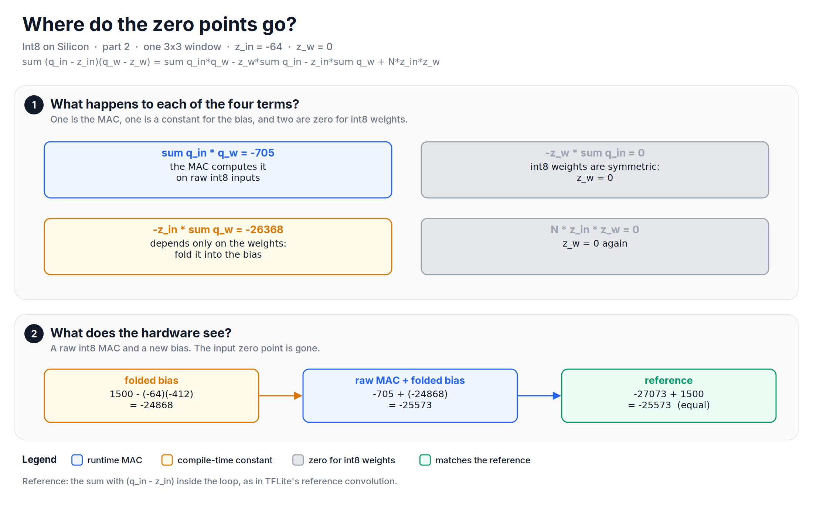
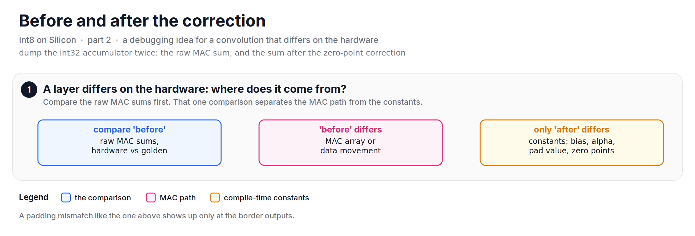

Lately, I have been writing down the integer math of an int8 accelerator that I worked on, and this note is about zero points: how they disappear before the hardware ever sees them, and the one place where they come back to bite.

In [part 1][part1], the post-processing unit had a per-channel bias, and I said that we would see where it comes from. This is that part.

## Before diving in, the four terms
A convolution output, before the multiply by $M$, is a sum over the window:

$$
acc = \sum (q_{in} - z_{in})(q_{w} - z_{w})
$$

If we multiply it out, we get four terms:

$$
acc = \sum q_{in} q_{w} \; - \; z_{w} \sum q_{in} \; - \; z_{in} \sum q_{w} \; + \; N z_{in} z_{w}
$$

where $N$ is the number of points in the window (9 for a 3X3 kernel with one input channel). Let's look at each term with real numbers: activations in [-1, 3], so $z_{in} = -64$, and int8 weights, so $z_{w} = 0$. The weights in this example sum to -412.

+ $\sum q_{in} q_{w}$ is -705. This is the only term that depends on both the input and the weights. The MAC array computes it, on the raw int8 inputs.
+ $z_{w} \sum q_{in}$ is 0. Int8 weights in TFLite are symmetric, so $z_{w} = 0$.
+ $z_{in} \sum q_{w}$ is $-64 \times -412 = 26368$. It depends only on the weights and on $z_{in}$, which are both known at compile time. So it is a constant per output channel.
+ $N z_{in} z_{w}$ is 0, because $z_{w} = 0$ again.

*Figure: of the four terms, only the MAC is computed at runtime. The input zero point moves into the bias.*

## Folding the zero point into the bias
Since the third term is a constant per channel, we can move it into the bias at compile time:

$$
bias' = bias - z_{in} \sum q_{w}
$$

For our window, the bias is 1500 and the folded bias is $1500 - (-64)(-412) = -24868$. The raw MAC gives -705, and $-705 + (-24868) = -25573$. The reference, with $(q_{in} - z_{in})$ inside the loop, gives $-27073 + 1500 = -25573$. They are equal.

It means that the hardware does not need to know that a zero point exists. The MAC array multiplies raw int8 values, and the post-processing unit adds one bias. TFLite's reference convolution does it the other way: it adds the input offset to every input inside the inner loop. That is one extra addition per multiply. In hardware, that is an adder in front of every multiplier, so we moved the work to the compiler.

When the weights do have a zero point (for example, in older uint8 models), the reference model subtracted it at runtime, inside the MAC loop. For the hardware files, the weights were written with the zero point already subtracted, as $q_{w} - z_{w}$, so the MAC never sees it. Then the second and fourth terms disappear too. There is a cost: $q_{w} - z_{w}$ can be anywhere in -255..255, which needs 9 bits instead of 8.

![Two panels. 1: the input offset added inside the loop costs 576 additions per output for a 3x3 convolution over 64 channels; folded into the bias it costs 1. 2: weights with zero point 3 are written for the hardware as q_w - z_w in [-131, 124]; in general they need 9 bits.](https://raw.githubusercontent.com/mrtpk/kaizen/master/learnings/20261107_int8_on_silicon_2/resources/fig3_offsets_and_debug.png)
*Figure: both offsets move from the hardware to the compiler.*

## The padding trap
Here is the catch. The folded bias subtracts $z_{in} \times$ the sum of **all 9 weights**. It assumes that all 9 points of the window are real inputs, so the $z_{in}$ correction applies to every weight. Inside the image, that is true. At the border, some points of the window are padding.

What value should a padded point have? A SAME convolution pads with zeros, and zero means the real value 0.0. In int8, the real value 0.0 is $z_{in}$ = -64, not 0. TFLite's reference convolution simply skips the padded points, which is the same as real 0.0.

Let's take the top-left corner of a 5X5 image. Its window has 5 padded points, and their weights sum to -40.

+ **Pad with $z_{in}$ (-64):** the MAC adds $-64 \times -40 = 2560$ for the padded points, and the folded bias removes exactly that 2560. The corner output is equal to the reference.
+ **Pad with 0:** the MAC adds nothing for the padded points, but the folded bias still removes 2560. The corner output is off by -2560. After the multiply by $M$, that is about 4 int8 steps.

*Figure: with a folded bias, the padding must hold the input zero point. Padding with 0 breaks every output that touches the border.*

With padding 0, all 16 border outputs of the 5X5 image are wrong, and only the 9 inner outputs are exact. For small feature maps and stride-2 layers, the border is a large share of the image. So, in our reference model, the padding value is always the input zero point, and the hardware got the same rule: the pad value was one of the constants that the compiler wrote for every convolution.

For the hardware export, one of the compiler passes (part 5) also split a SAME convolution into an explicit pad layer and a VALID convolution. With an explicit pad layer, the pad value is a visible constant in the layer list, and the convolution itself has no border case. I wrote about how TensorFlow splits SAME padding into top, bottom, left and right in [an older note][tf-padding].

## A debugging aid
When a convolution on the hardware does not match the reference model, the first question is: is the MAC wrong, or is the correction wrong? The reference model has two named accumulator dumps for convolutions for this question: before and after the zero-point correction. In the version of the code I have now, both dumps hold the same values, because the correction moved into the post-processing step, after the dump. The idea is still worth keeping. If "before" matches, the MAC array is fine and the difference is in the constants. If "before" does not match, it is in the MAC or in the data movement. A padding mismatch of the kind above shows up only at the border outputs.

*Figure: two accumulator dumps, before and after the correction, split a mismatch into a MAC question or a constants question.*

## Let's look at the code
A 3X3 SAME convolution on a 5X5 image, done three ways:


import numpy as np

rng = np.random.default_rng(0)
z_in, K = -64, 3
q_w = rng.integers(-127, 128, (K, K))       # symmetric int8 weights, z_w = 0
q_in = rng.integers(-128, 128, (5, 5))
bias = 1500
bias_folded = bias - z_in * int(q_w.sum())  # compile time

def reference(q):                           # TFLite style: skip padding, offset in the loop
    out = np.zeros((5, 5), dtype=np.int64)
    for y in range(5):
        for x in range(5):
            for dy in range(K):
                for dx in range(K):
                    iy, ix = y + dy - 1, x + dx - 1
                    if 0 <= iy < 5 and 0 <= ix < 5:
                        out[y, x] += int(q_w[dy, dx]) * (int(q[iy, ix]) - z_in)
    return out + bias

def folded(q, pad_value):                   # ours: pad, raw MAC, folded bias
    p = np.pad(q, 1, constant_values=pad_value)
    out = np.array([[int((p[y:y + K, x:x + K] * q_w).sum()) for x in range(5)] for y in range(5)])
    return out + bias_folded

ref = reference(q_in)
print("Pad with z_in. Is pass?", np.array_equal(folded(q_in, z_in), ref))      # True
print("Pad with 0. Is pass?", np.array_equal(folded(q_in, 0), ref))            # False
print("Wrong outputs with pad 0:", int((folded(q_in, 0) != ref).sum()))        # 16


The full script, with the four terms and the weight zero point case, is available [here](https://github.com/mrtpk/kaizen/tree/master/learnings/20261107_int8_on_silicon_2).

So, in short: the input zero point moves into the bias at compile time, the weight zero point is zero (or is subtracted from the weights offline), and the MAC array multiplies raw int8 values. The price is one rule that must never break: pad with the input zero point, not with 0.

In part 3, we will see how the same post-processing unit runs operations that are not convolutions at all: add, multiply, and the ReLU family.

**Reference:**
+ [Int8 on Silicon - Part 1: One multiply, one shift][part1]
+ [TensorFlow's padding in convolution layer][tf-padding]
+ [TFLite reference int8 convolution (v2.16.1)][tflite-conv]

[part1]: https://github.com/mrtpk/kaizen/tree/master/learnings/20261107_int8_on_silicon_1
[tf-padding]: https://github.com/mrtpk/kaizen/tree/master/learnings/tensorflow_padding
[tflite-conv]: https://github.com/tensorflow/tensorflow/blob/v2.16.1/tensorflow/lite/kernels/internal/reference/integer_ops/conv.h
