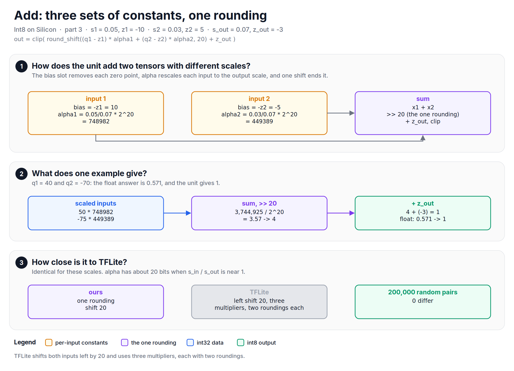
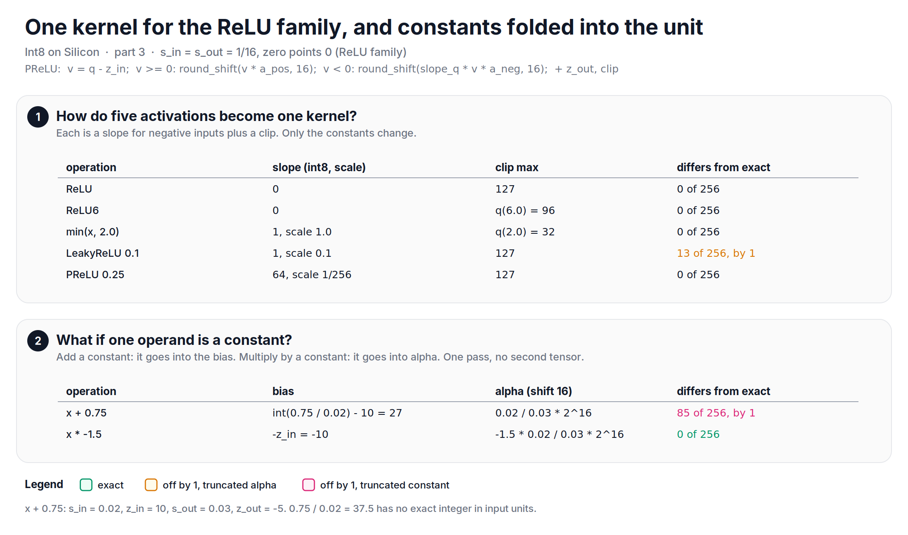
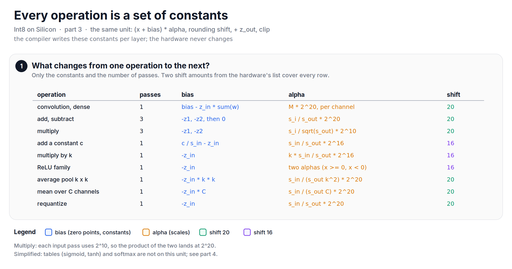

Lately, I have been writing down the integer math of an int8 accelerator that I worked on, and this note is about how one small post-processing unit ran operations that are not convolutions at all: add, multiply, operations with a constant, and the whole ReLU family.

In [part 1][part1], every layer ended in the same unit: add a bias, multiply by an integer `alpha`, shift right with rounding, add the output zero point, clip. In [part 2][part2], the bias took over the zero points. The question for this part is: if that unit is all we have, how do we run everything else?

## Add: three sets of constants, one rounding
An add of two int8 tensors looks simple, but the two inputs usually have different scales and zero points, and the output has a third scale. In real numbers:

$$
r_{out} = s_1 (q_1 - z_1) + s_2 (q_2 - z_2)
$$

so

$$
q_{out} = z_{out} + \frac{s_1}{s_{out}} (q_1 - z_1) + \frac{s_2}{s_{out}} (q_2 - z_2)
$$

Each input needs its own zero point removed and its own rescale. That is exactly what the unit does: the bias slot holds $-z_i$, and `alpha` holds $\frac{s_i}{s_{out}} \cdot 2^{20}$. So, for an add, the compiler wrote three sets of constants: one for each input, and one for the sum, which does the single rounding shift by 20, adds $z_{out}$ and clips.

Let's say $s_1 = 0.05, z_1 = -10$, $s_2 = 0.03, z_2 = 5$ and $s_{out} = 0.07, z_{out} = -3$. Then `alpha1` is 748982 and `alpha2` is 449389. For $q_1 = 40$ and $q_2 = -70$:

$$
50 \times 748982 + (-75) \times 449389 = 3744925, \quad 3744925 / 2^{20} = 3.57 \rightarrow 4, \quad 4 + (-3) = 1
$$

The float answer is 0.571, which also rounds to 1.

*Figure: an add is three sets of constants for the same unit, and one rounding at the end.*

TFLite does the add differently: it shifts both inputs left by 20 and uses three multipliers, each with its own two roundings. For these scales, our result and TFLite's are identical: 0 of 200,000 random input pairs differ. It makes sense: $s_i / s_{out}$ is near 1, so `alpha` has about 20 bits of precision, and one rounding of a precise value is as good as it gets. It is a good example of how a layer can match TFLite exactly, even though the arithmetic is different.

## Multiply: the square-root split
A multiply of two tensors is different, because the scales multiply:

$$
q_{out} = z_{out} + \frac{s_1 s_2}{s_{out}} (q_1 - z_1)(q_2 - z_2)
$$

Our reference model split the multiplier into two square roots, one per input:

$$
\frac{s_1 s_2}{s_{out}} = \frac{s_1}{\sqrt{s_{out}}} \cdot \frac{s_2}{\sqrt{s_{out}}}
$$

Each input gets its own `alpha` at $2^{10}$: $a_i = \frac{s_i}{\sqrt{s_{out}}} \cdot 2^{10}$. Each input goes through the unit with bias $-z_i$ and its `alpha`, the two results are multiplied, and the product lands at $2^{20}$, a supported shift.

Two things shaped this. The first is a hardware constraint: the accumulator was 32 bits, so the product of the two scaled inputs had to fit in 32 bits. A comment in our code says it plainly: each scaled input stays near 16 bits, so that their product fits. The second is accuracy. An earlier version, still in the code as a comment, split the multiplier unevenly: $\frac{s_1}{s_{out}}$ on one input and $s_2$ on the other, each at $2^{10}$. Splitting it evenly with square roots gives each `alpha` a fair share of the bits. For $s_1 = 0.05$, $s_2 = 0.03$ and $s_{out} = 0.12$, the uneven version differs from exact rounding in 62% of the outputs, by up to 4. The square-root split brings that down to 46%, by up to 2.

While writing this note, I also measured where the split still loses precision. With $2^{10}$ per side and `int()` truncation, each `alpha` has only a few bits: 147 and 88 in the example above. The squeeze-and-excitation block, where an activation is multiplied by a sigmoid output, is the hardest case. A sigmoid output in TFLite has scale 1/256, so its `alpha` comes out as 17, a 5-bit multiplier, and 75% of the outputs differ from exact rounding, by up to 7. (Interestingly, the uneven version does well here, because $\frac{1}{256} \cdot 2^{10} = 4$ is exact.)

*Figure: the square-root split balances the bits between the two inputs so that the product fits in 32 bits. Rounding the alphas, or putting all of M on one input, gets closer still to exact.*

With what I know now, two refinements would close most of the remaining gap. Rounding the alphas instead of truncating them brings it to about 20% of the outputs, never more than 1. Putting all of $M$ on one input, `alpha` = $M \cdot 2^{20}$, and leaving the other input unscaled brings the SE block to 0.05%, which is closer to exact than TFLite. That product also fits in 32 bits, for the same reason as in part 1: it is the output value with 20 fraction bits. The final model accuracy was on par with TFLite, so the models we evaluated handled the multiply well. If I built it again, I would try the one-sided version first.

## Operations with a constant
Many graphs have operations like "add 0.75" or "multiply by -1.5", where one operand is a constant. These do not need a second tensor at all. The constant folds into the unit:

+ **Add a constant $c$:** the bias becomes $c / s_{in} - z_{in}$, and `alpha` is $\frac{s_{in}}{s_{out}} \cdot 2^{16}$.
+ **Multiply by a constant $k$:** the bias is $-z_{in}$, and `alpha` is $k \cdot \frac{s_{in}}{s_{out}} \cdot 2^{16}$.

One pass, no memory traffic for a second input. There is one trap in the add: $c / s_{in}$ must be an integer. For $c = 0.75$ and $s_{in} = 0.02$, it is 37.5, and the bias can hold only 37 or 38. We truncated it to 37, and 85 of the 256 possible inputs come out 1 off. Multiplying by -1.5 with the same scales is exact for all 256 inputs.

## The ReLU family is one kernel
Here is a neat trick of the reference model. ReLU, ReLU6, LeakyReLU, PReLU and "minimum with a constant" are all the same operation with different constants: a slope for negative inputs, and a clip.

$$
y = \begin{cases} x & x \geq 0 \\ slope \cdot x & x < 0 \end{cases}, \quad \text{then clip to } [lo, hi]
$$

+ **ReLU:** slope 0.
+ **ReLU6:** slope 0, and the clip maximum is the int8 value of 6.0.
+ **LeakyReLU 0.1:** the slope is stored as an int8 value of 1 with a scale of 0.1.
+ **PReLU:** the slope tensor, with its own scale and zero point.
+ **minimum(x, 2.0):** slope 1, and the clip maximum is the int8 value of 2.0.

So one PReLU kernel, with two alphas at $2^{16}$ (one for the positive side and one for the negative side), runs all five. With $s_{in} = s_{out} = 1/16$, ReLU, ReLU6, PReLU 0.25 and the minimum are exact for all 256 inputs. LeakyReLU 0.1 is off by 1 for 13 of them, because its negative `alpha` is 6553.6, truncated to 6553.

*Figure: five activations are one PReLU kernel with different constants, and constant operands fold into the bias or alpha.*

You may have noticed that these operations use a shift of 16, and add and convolution use 20. That is simply what the hardware supported: each operation used a shift amount from the hardware's short list.

Let's put all of it in one table. Every operation in this note, and the pooling from the next one, is the same unit with different constants:

*Figure: every operation is a set of constants for the same post-processing unit. Only the constants and the number of passes change.*

## Let's look at the code
The add and the multiply, checked against exact rounding:


import math
import numpy as np

def round_shift(x, shift):                       # round half away from zero
    a = np.abs(x)
    r = (a >> shift) + ((a >> (shift - 1)) & 1)
    return np.where(x < 0, -r, r)

def exact(r, s, z):                              # float reference
    v = r / s
    return np.clip(np.sign(v) * np.floor(np.abs(v) + 0.5) + z, -128, 127)

rng = np.random.default_rng(0)
q1, q2 = rng.integers(-128, 128, (2, 200_000))

# add: s1 0.05 / z1 -10, s2 0.03 / z2 5, s_out 0.07 / z_out -3
a1, a2 = int(0.05 / 0.07 * 2**20), int(0.03 / 0.07 * 2**20)
add = np.clip(round_shift((q1 + 10) * a1 + (q2 - 5) * a2, 20) - 3, -128, 127)
print("Add equals exact. Is pass?", np.array_equal(add, exact(0.05 * (q1 + 10) + 0.03 * (q2 - 5), 0.07, -3)))

# SE block multiply: x (0.05 / -10) * sigmoid (1/256 / -128), s_out 0.05 / z_out -10
s1, s2, so = 0.05, 1 / 256, 0.05
ref = exact(s1 * (q1 + 10) * s2 * (q2 + 128), so, -10)
m1, m2 = int(s1 / math.sqrt(so) * 2**10), int(s2 / math.sqrt(so) * 2**10)   # 228, 17
split = np.clip(round_shift((q1 + 10) * m1 * ((q2 + 128) * m2), 20) - 10, -128, 127)
one_side = np.clip(round_shift((q1 + 10) * (q2 + 128) * round(s1 * s2 / so * 2**20), 20) - 10, -128, 127)
print(f"Split: {(split != ref).mean() * 100:.1f} % differ, max {np.abs(split - ref).max()}")      # 75 %, 7
print(f"One side: {(one_side != ref).mean() * 100:.2f} % differ, max {np.abs(one_side - ref).max()}")  # 0.05 %, 1


The full script, with TFLite's add and multiply reimplemented for comparison, the constants and the ReLU family, is available [here](https://github.com/mrtpk/kaizen/tree/master/learnings/20261107_int8_on_silicon_3).

So, in short: with the bias slot for zero points and `alpha` for scales, one post-processing unit covers add (three constant sets), multiply (two scaled inputs and a product), constant operands (folded into bias or alpha), and five activations (one PReLU kernel). The add matched TFLite exactly. The multiply balanced its bits to fit a 32-bit accumulator, and now I know how much further it can go.

In part 4, we will look at the operations that need a division or a non-linear function: mean, average pooling, sigmoid, softmax and resize, on hardware without a divider.

**Reference:**
+ [Int8 on Silicon - Part 1: One multiply, one shift][part1]
+ [Int8 on Silicon - Part 2: Making zero points disappear][part2]
+ [TFLite int8 add (v2.16.1)][tflite-add]
+ [TFLite reference int8 mul (v2.16.1)][tflite-mul]
+ [Squeeze-and-Excitation Networks][se-net]

[part1]: https://github.com/mrtpk/kaizen/tree/master/learnings/20261107_int8_on_silicon_1
[part2]: https://github.com/mrtpk/kaizen/tree/master/learnings/20261107_int8_on_silicon_2
[tflite-add]: https://github.com/tensorflow/tensorflow/blob/v2.16.1/tensorflow/lite/kernels/add.cc
[tflite-mul]: https://github.com/tensorflow/tensorflow/blob/v2.16.1/tensorflow/lite/kernels/internal/reference/integer_ops/mul.h
[se-net]: https://arxiv.org/abs/1709.01507
