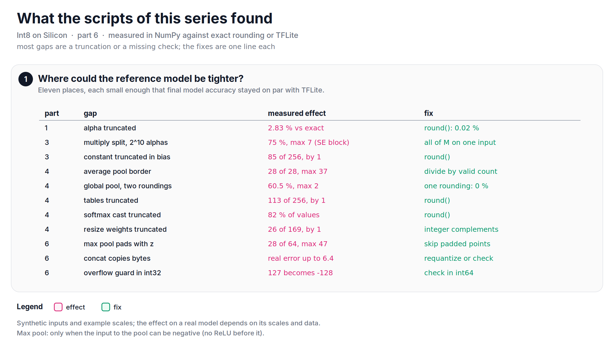

Lately, I have been writing down the integer math of an int8 accelerator that I worked on at Roviero, and this last note looks back: what held up, and what I would refine if I built the reference model again.

Before this series, I would have said that the reference model was correct, because the hardware matched it bit for bit and the final accuracy was on par with TFLite in our tests on full datasets. Both are true, though I no longer have the final accuracy numbers. But for every part of this series, I rewrote the math in NumPy and compared it with exact rounding and with TFLite's integer kernels, and the scripts found small gaps that on-par accuracy did not show.

## What held up
Let's start with what I would keep.

+ **One post-processing unit for everything** ([part 1][part1], [part 3][part3]). Bias, multiply, shift, zero point, clip. Convolution, add, multiply, constants, the whole ReLU family and average pooling all fit in it. One unit means one thing to verify.
+ **A fixed shift of 20, one rounding** ([part 1][part1]). I only understood this fully while writing this note: with a 32-bit product and 4 bits of headroom, 20 is the largest shift there is. The product `alpha * acc` is the output value with `shift` fraction bits. An int8 output needs a sign bit and 7 bits of magnitude, and 4 spare bits keep it safe, so $31 - 7 - 4 = 20$. A bigger shift buys precision for `alpha` but eats the range. At 24 there are no spare bits left, and at 28 the int8 range itself overflows.
+ **Zero points folded into the bias** ([part 2][part2]). The MAC array never saw a zero point.
+ **Tables for one-input functions, the host for the rest** ([part 4][part4]).
+ **Golden files that a human can read** ([part 5][part5]). Plain text, one value per line, readable by a hardware engineer.
+ **Two targets, never mixed up**: bit-exact with the hardware, accurate like TFLite.

*Figure: the decisions I would make again, each with the part of the series that backs it.*

## What I would change
**1. Round every constant.** This is the biggest lesson, and it is the cheapest one. In many places, a float constant became an integer with `int()`, which truncates: `alpha` in convolution ([part 1][part1]), the two alphas of the multiply ([part 3][part3]), a constant folded into a bias ([part 3][part3]), the lookup tables and the softmax cast ([part 4][part4]), and the resize weights ([part 4][part4]). For the convolution in part 1, rounding `alpha` instead of truncating it takes the mismatch with exact rounding from 2.83% of the outputs to 0.02%, which is better than TFLite's 0.18%. The single rounding was right all along; rounding the constants is the missing piece.

**2. One rounding, everywhere.** Global average pooling rounded twice: once for the mean and once for the rescale. For a scale ratio of 2.5, 60% of the outputs differ from exact rounding. With one rounding, none do ([part 4][part4]).

**3. Make the border rules explicit.** Two operations had a different border from TFLite. Average pooling as a convolution divides by 9 at the border, where TFLite divides by the number of valid points: the border outputs were off by up to 37 ([part 4][part4]). Max pooling padded with the zero point, which is the real value 0.0. If the input to the pool can be negative (no ReLU before it), a padded 0.0 wins the max. In a test with mostly negative inputs, 28 of the 64 outputs of an 8X8 map differ, by up to 47 steps. TFLite skips the padded points. Both are one-line fixes, but only if somebody writes the border rule down.

**4. Check every assumption, in a wider type.** Two checks in the reference model could not fail. An overflow check ran on a product that was already computed in int32, so it only ever saw the wrapped value. And an "is this the same as the 64-bit result?" assert computed its 64-bit reference from the same int32 product. When `alpha * acc` overflows, the result does not just lose precision, it changes sign: 127 becomes -128.

*Figure: an overflow that flips the sign, and two checks that could not see it.*

The same goes for concat. It copied the bytes of its inputs, which is right only when all inputs have the same scale and zero point as the output, and nothing in the reference model checked that. With input scales of 0.05 and 0.10 and an output scale of 0.10, copying gives a real error of up to 6.4. TFLite's int8 reference kernel copies too, so it relies on the same matching scales. The gap is only the missing check.

**5. Take the multiply one step further.** The square-root split of [part 3][part3] balanced the bits between the two inputs so that the product fits the 32-bit accumulator, and it was more accurate than the uneven split before it. With rounded alphas, or with all of $M$ on one input, it gets closer still: for a squeeze-and-excitation block, from 75% of the outputs off exact rounding to 0.05%.

**6. Ask for a wider product.** Truncation was a software problem. The precision of `alpha` for very small $M$ is a hardware one. With a 32-bit product and a shift of 20, $M = 0.0001$ leaves only 7 bits in `alpha`. A 40-bit product would allow a shift of 28 and 15 bits of `alpha`, for every $M$. If I could ask the hardware team for one thing, it would be 8 more bits in the post-processing multiplier.

*Figure: alpha and the product share the same 32 bits. A shift of 20 was the best a 32-bit product allows; more precision needs a wider product.*

**7. Test the edges, not only the models.** None of the gaps above showed up in full-dataset accuracy tests. They were found by tests that a dataset never produces: a huge accumulator, all-negative inputs before a pool, mismatched scales, a non-integer resize ratio, every one of the 256 inputs of a table. A trained network rarely goes to these edges. That is exactly why they need their own tests.

*Figure: what the scripts of this series found. Most fixes are one line.*

## Let's look at the code
The overflow, the max pool border and the concat, each in a few lines:


import numpy as np

# 1. an overflow that the int32 check cannot see
alpha, acc = np.int32(2416), np.int32(1_000_000)
with np.errstate(over="ignore"):
    p32 = alpha * acc                                    # wraps to -1,878,967,296
p64 = np.int64(alpha) * np.int64(acc)                    # 2,416,000,000
print("int32 check fires. Is pass?", not (-2**31 <= int(p32) < 2**31))    # False
print("int64 check fires. Is pass?", not (-2**31 <= int(p64) < 2**31))    # True
print("output:", max(min(int(p32) >> 20, 127), -128), "instead of", max(min(int(p64) >> 20, 127), -128))  # -128 instead of 127

# 2. max pool: pad with the zero point (real 0.0) vs skip padded points
rng = np.random.default_rng(0)
z = 20
q = rng.integers(-128, 20, (8, 8))                       # mostly negative real values
p = np.pad(q, 1, constant_values=z)
ours = np.array([[p[y:y + 3, x:x + 3].max() for x in range(8)] for y in range(8)])
tfl = np.array([[q[max(0, y - 1):y + 2, max(0, x - 1):x + 2].max() for x in range(8)] for y in range(8)])
print("Max pool equal. Is pass?", np.array_equal(ours, tfl), "-", int((ours != tfl).sum()), "of 64 differ")   # False - 28

# 3. concat with different input scales: copy vs requantize
a, b = rng.integers(-128, 128, (2, 1000))
real = np.concatenate([a * 0.05, b * 0.10])
copy = np.concatenate([a, b]) * 0.10
requant = np.concatenate([np.clip(np.round(a * 0.05 / 0.10), -128, 127), b]) * 0.10
print(f"copy: {np.abs(copy - real).max():.2f}, requantize: {np.abs(requant - real).max():.3f}")   # 6.40, 0.050


The full script, with the bit budget table, is available [here](https://github.com/mrtpk/kaizen/tree/master/learnings/20261107_int8_on_silicon_6).

## Looking back
Roviero did not make it, for the reasons in part 1. Since then, I have worked on NPU compilers and on LLM inference, and the same questions keep coming back in new forms: a scale per channel or per group, an integer multiplier and a shift, how many bits the product has, what happens at the edges. The answers in this series are not the only ones, but they are written down now, with the numbers. That was the point.

So, in short: one unit, one shift of 20 and one rounding were the right design for a 32-bit product. The gaps were in the details: truncated constants, one extra rounding, unwritten border rules, and checks in a narrower integer type than they needed. Round every constant, check in a wider type, write the border rules down, and test the edges.

**Reference:**
+ [TFLite reference int8 pooling (v2.16.1)][tflite-pool]
+ [TFLite reference concatenation (v2.16.1)][tflite-concat]

**The series:**
+ [Quantization Basics - The quantization formula, from number lines][quant-basics]
+ [Int8 on Silicon - Part 1: One multiply, one shift][part1]
+ [Int8 on Silicon - Part 2: Making zero points disappear][part2]
+ [Int8 on Silicon - Part 3: One unit, many operations][part3]
+ [Int8 on Silicon - Part 4: Operations without a divider][part4]
+ [Int8 on Silicon - Part 5: The compiler frontend, and how we verified it][part5]

[quant-basics]: https://github.com/mrtpk/kaizen/tree/master/learnings/20261107_quantization_formula
[part1]: https://github.com/mrtpk/kaizen/tree/master/learnings/20261107_int8_on_silicon_1
[part2]: https://github.com/mrtpk/kaizen/tree/master/learnings/20261107_int8_on_silicon_2
[part3]: https://github.com/mrtpk/kaizen/tree/master/learnings/20261107_int8_on_silicon_3
[part4]: https://github.com/mrtpk/kaizen/tree/master/learnings/20261107_int8_on_silicon_4
[part5]: https://github.com/mrtpk/kaizen/tree/master/learnings/20261107_int8_on_silicon_5
[tflite-pool]: https://github.com/tensorflow/tensorflow/blob/v2.16.1/tensorflow/lite/kernels/internal/reference/integer_ops/pooling.h
[tflite-concat]: https://github.com/tensorflow/tensorflow/blob/v2.16.1/tensorflow/lite/kernels/internal/reference/concatenation.h
