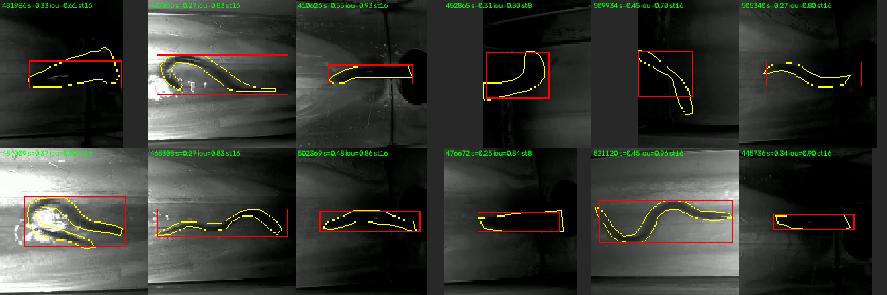
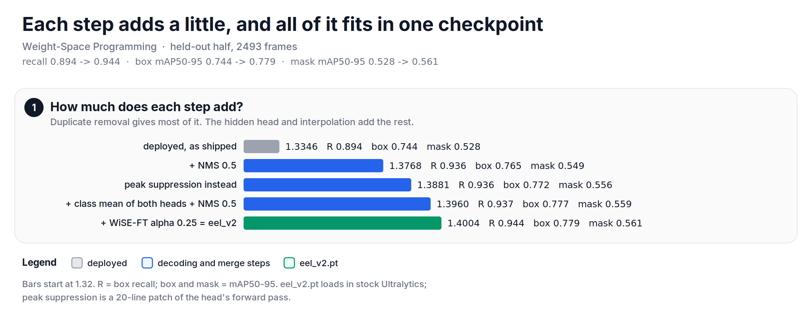
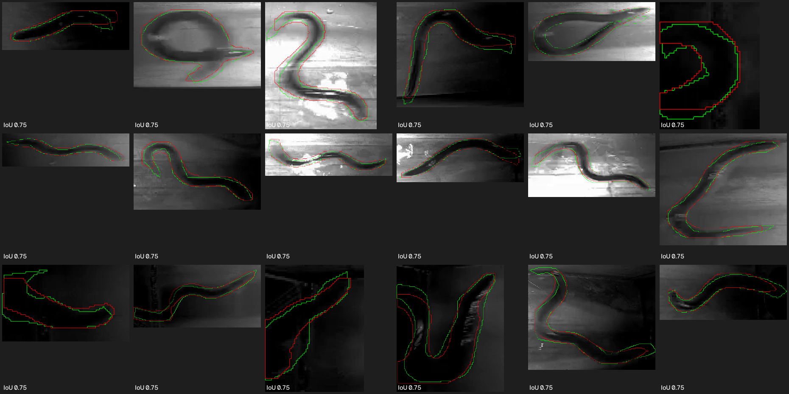

Lately, I have been reading about weight-space programming, and this note is about trying it on a small vision model that is in use: a YOLO26n segmentation model that finds American eels in infrared video. I wanted to know two things. Can I understand the model by reading its weights? And can I fix its errors by changing its weights directly, with no new data?

The short answer: the weights explained the model well, but they could not fix its misses. Three exact changes to the model and its decoding did remove most of its false positives. On frames that no edit was fitted on, recall went from 0.894 to 0.944. The mask boundaries were the hardest part, and I only partly fixed them.

I ran this study with Claude Code as the agent that wrote and ran the experiments. I set the goals, asked the questions and checked the results. It ran on a CPU for about two days, mostly unattended.

The model and the footage are not public, so the study code is not in this repo. The script next to this note runs each method on small synthetic arrays, and it prints the study's results from an export of the experiment logs. Every number in this note comes from that script.

*Figure: the map of this note. Green worked, orange worked partly, pink did not work.*

## Before diving in, what is weight-space programming?
Weight-space programming means changing a network by reading and rewriting its weights, from an understanding of what each part computes, instead of training it with gradient descent. The term comes from [Sparks of Weight-Space Programming][mit] by Takehi, Teoh, Zhang and Khattab at MIT CSAIL. In their headline result, an LLM edited 131,072 weights (0.016 %) of Qwen3.5-0.8B to remove a looping bug, and its MATH-500 score rose from 7.9 % to 48.1 %. They also report where it failed: a Gemma 3 270M model whose math score editing could not raise. They read that as "an edit cannot add an ability the model lacks". An older line of work edits models with arithmetic on weights, called [task vectors][task-arith] ([and in the tangent space][tangent]).

My question was whether the idea carries over to a small detector. Can I find a "bug" in the weights, and fix it with a small edit?

## The model and the data
Let's look at what I had.

| Item | Detail |
| --- | --- |
| Model | YOLO26n-seg, 3.06M parameters, fp16, Ultralytics 8.4.22 |
| Head | end-to-end one-to-one head, no NMS |
| Class slots | 22 (`fish`, 20 species, and `American_Eel` = class 21) |
| Frames | 4986 infrared frames, 640 x 360, from one video |
| Labels | 5013 eel polygons, all class 21 |
| Clips | about 366 clips of about 13 consecutive frames each |
| Compute | CPU only, 14 cores |

There is a catch, and it shapes the whole study. Every frame I had was in the model's training set. The training list covers every frame of the video with no gaps. So there was no held-out data.

Neighbouring frames are near-duplicates, so a random split leaks: a frame and its neighbour look the same. I split the video by time instead. I fit every edit on the first half (frames before 470754) and score it on the second half (2493 frames). I call the second half "held-out" in this note. It is held out from the edits, not from the original training. Keep that in mind for every number below.

The score I use most is the one Ultralytics uses to pick the best checkpoint. I call it fitness:

$$
\text{fitness} = \sum_{\text{box, mask}} \left( 0.1 \cdot \text{mAP}_{50} + 0.9 \cdot \text{mAP}_{50\text{-}95} \right)
$$

It goes from 0 to 2. The deployed model scores 1.3346 on the held-out half.

# Part 1: Can the weights explain and fix the model?

## What do the class biases say?
Each detection scale has a classifier with one row per class. Each row has a bias. Before I ran a single frame, the biases told a story:

| Classifier row | stride 8 | stride 16 | stride 32 |
| --- | --- | --- | --- |
| 21 unused classes | -12.98 | -12.03 | -8.0 |
| American_Eel | -2.17 | +1.18 | -8.0 |

The 21 unused rows are identical. They were only ever pushed down as negatives, because the labels contain only eels. And at stride 32, the eel row has the same bias as the dead rows. That suggests that the coarsest scale never learned eels.

Both readings held up when I ran the model. The 1003-eel diagnostic found detections at stride 8 (76) and stride 16 (846), and none at stride 32. Setting the stride-32 eel bias to -100 changed nothing on 200 frames: same boxes, same confidences, same mask pixels.

*Figure: the biases show a one-class model with a dead scale. The misses are short eels.*

## Exact surgery: 22 classes to 1
If 21 rows are dead, I can cut them out. Every layer whose output has one channel per class (the two classifier branches and the semantic mask head) keeps only row 21. A logit is a dot product of a row and the features, so the eel logit does not depend on the other rows. It is exact by construction:


feats = rng.normal(size=(64, 100))                 # 64 features at 100 anchors
w, b = rng.normal(size=(22, 64)), rng.normal(size=22)
full = w @ feats + b[:, None]                      # 22 class logits per anchor
eel = w[21:22] @ feats + b[21:22, None]            # the sliced 1-class head
print("Pruning is exact (to float rounding). Is pass?", np.abs(full[21:22] - eel).max() < 1e-12)   # True


On the real model, all metrics on 4986 frames agreed to 16 decimal places. A frame-by-frame check on 200 frames found zero difference in boxes, confidences and mask pixels. This is the easy, safe kind of weight edit: surgery on parts you can prove are unused.

## Where are the misses?
The model finds 922 of 1003 eels (91.9 %) at confidence 0.25, in every fifth frame. The misses are short eels: 38.1 % recall under 60 px and 71.1 % at 60 to 100 px, against 98.8 % at 150 to 250 px.

How does it miss them? For each missed eel, I looked for the best box any anchor proposed. Of 81 misses, 78 had a well-placed box (IoU 0.5 or more) whose score was too low, with a median score of 0.039. Only 3 were localization failures. So the misses are score failures, and almost all short-eel detections come from stride 8. That points at one place in the weights: the stride-8 eel row.

Is it the input size? I reran the diagnostic at larger inputs. Recall under 60 px was 33 % at 640 px and 36 % at 768 px, against 38 % at 512 px. The detections only moved from stride 8 to stride 16. So the limit is not pixels.

Then I looked at the missed short eels themselves.

*Figure: sixteen missed eels under 100 px. L = label length in px, s = best score. Most are long eels cut off by the opening or the frame edge, or eels in frames too dark to see.*

Most of them are not small eels. They are long eels cut off where they enter the dark opening or leave the frame, and several sit in frames so dark that I cannot see an eel at all. Those labels may come from tracking. This is my judgement from low-resolution crops, and it needs someone who knows the footage to confirm it.

## Can an edit of the stride-8 row win them back?
The stride-8 eel score is a linear function of 64 features. So I cached the features once, and I could score any edit of that row exactly, without rerunning the network. I tried two edits, fitted on the first half and scored on the second half, which has 67 missed short eels:
- a bias shift (the row says "eel" more often);
- a rank-1 edit along the LDA direction, which is the direction that best separates the missed eels from the background in the 64 features.

*Figure: every eel won by an edit costs 11 to 29 false positives. Even the best linear row is only a little better on new frames.*

Every edit buys a few eels at a high price. Maybe I picked bad edits? To find out, I fitted a class-weighted logistic regression on the same 64 features: the best linear row there can be. This was a measurement, not an edit to keep. On the other half, it is no better than the current row at low recall, and only somewhat better at 51 % recall.

And there is a lesson in the last column. The same probe, scored on the half it was fitted on, looks 1.7 to 3.5 times better. If I had judged it in-sample, I would have called it a success. With near-duplicate frames, this leak is easy to fall into.

So the 64 features do not carry what separates these eels from the background. No edit of this row can fix them. This is the Gemma result from the MIT post, on a detector: an edit cannot add information that the features do not have.

## Why are the mask scores so low?
Box mAP50-95 is 0.762 on all frames, but mask mAP50-95 is only 0.549. The reason is geometry. YOLO draws masks on a grid at 1/4 of the input size. At 512 px input, the median eel is about 2 grid cells wide. I rasterized each label polygon on that grid, and again shifted by half a cell, to see what a perfect mask that is only slightly misplaced scores:

| Input | Mask grid | Mean IoU | IoU 0.75 or more |
| --- | --- | --- | --- |
| 512 px | 128 x 72 | 0.65 | 14.1 % |
| 640 px | 160 x 90 | 0.71 | 29.6 % |
| 768 px | 192 x 108 | 0.74 | 49.0 % |
| 1024 px | 256 x 144 | 0.80 | 80.2 % |

At 512 px, even near-perfect masks mostly fail the strict IoU thresholds that make up mAP50-95. I come back to masks in part 2.

## How robust is the fit?
With no held-out footage, I re-scored the model on 998 frames under realistic changes. Box mAP50 is 0.9645 clean. Brightness, blur, JPEG, flips, grayscale and input size change it by less than 0.013. Two changes hurt: low contrast (0.8283) and sensor noise (0.8791). These are the conditions of turbid water and low light, and the same conditions as many missed eels.

## Could I have found all this without the weights?
Mostly, yes, and I want to be honest about it. The dead classes are clear from the labels. The short-eel gap is clear from predictions binned by size. The score failures need the head's raw outputs, not its weights. Only "stride 32 is dead" came first, and cheaply, from the weights: its eel bias matched the dead rows. Even that I confirmed by observing outputs.

So in part 1, the weights were a fast first look that produced good guesses. The model's misses come from missing information (dark, cut-off, ambiguous eels) and from resolution, not from a few bad weights.

# Part 2: False positives, the hidden head, interpolation and masks

## What are the false positives?
Part 1 was about misses. I then looked at the other error. I classified every detection at confidence 0.25 on all 4986 frames against the labels.

![Two panels. 1: bars of false-positive types; 166 duplicates at the same scale (165 on the next cell), 163 duplicates at the other scale, 73 mislocalized (62 on missed eels), 1 background. 2: a 5 by 5 grid of stride-16 cells with a 3 by 3 window; the centre cell has logit 3.0 and its right neighbour 2.0; the rule keeps a cell only if it is the maximum of its window and of the neighbouring scales; after it, duplicates fall from 329 to 1, mislocalized from 73 to 58, true positives from 4613 to 4611.](https://raw.githubusercontent.com/mrtpk/kaizen/master/learnings/20261108_eel_weight_space/resources/fig3_false_positives.png)
*Figure: 329 of 403 false positives are second boxes on eels that were already found. Peak suppression removes all but 1.*

The answer was simple. 329 of the 403 false positives (82 %) are duplicates: a second box on an eel that already has a correct box. 166 sit on the same scale, and 165 of those on the cell right next to the true positive. The other 163 are cross-scale doubles, where stride 8 and stride 16 both fire. Background false positives almost do not exist: 1 in 4986 frames.

*Figure: duplicate detections. Each red box is a second box on an eel that already has a true positive. s = score, iou = IoU with the label, st = stride.*

A duplicate scores about 0.67 times its true positive. So a higher confidence threshold cannot remove them: it would remove the true eels first. YOLO26 is "NMS-free": its one-to-one head is trained to give one box per object. On this model, it does not quite.

## Peak suppression: one box per eel, still without NMS
The duplicates sit on the neighbouring cell or the neighbouring scale. [CenterNet][centernet] has a trick for this: keep a detection only where its score is a local maximum. I apply it to the class logits before decoding, and I add a check across scales:
- a cell keeps its eel logit only if it is the maximum of its own 3 x 3 neighbourhood;
- and it is not beaten by the overlapping 3 x 3 neighbourhood of the next coarser scale, or of the next finer scale;
- every other cell gets -20 on its logit, which sets its score to about 0.

There is nothing to fit. Let's look at the code. The toy example has two eels. Eel A has a peak at stride 16, a duplicate on the next cell, and a cross-scale double at stride 8. Eel B is a short eel at stride 8 only:


def peak_suppress(maps, penalty=20.0):
    out = []
    for i, m in enumerate(maps):                                # finest scale first
        keep = m >= maxpool3(m)                                 # max of its own 3x3
        if i + 1 < len(maps):                                   # coarser scale, upsampled
            up = np.kron(maxpool3(maps[i + 1]), np.ones((2, 2)))[:m.shape[0], :m.shape[1]]
            keep &= m >= up
        if i > 0:                                               # finer scale, pooled 2x2
            f = maxpool3(maps[i - 1])
            f = f[:2 * m.shape[0], :2 * m.shape[1]].reshape(m.shape[0], 2, m.shape[1], 2).max(axis=(1, 3))
            keep &= m >= f
        out.append(np.where(keep, m, m - penalty))
    return out

maps = toy_maps()
print(count_boxes(maps), count_boxes(peak_suppress(maps)))                 # 4 2
print("One box per eel after peak suppression. Is pass?", count_boxes(peak_suppress(maps)) == 2)   # True


On the real model it is a 20-line patch of the head's forward pass. On all frames, duplicates fell from 329 to 1, mislocalized boxes from 73 to 58, and true positives went from 4613 to 4611.

I tried variants on every fifth frame (the subset). Peak suppression alone scores 1.4314 there, against 1.3789 for the deployed head. A 5 x 5 window scored 1.4339, the same within noise. A soft penalty is worse: -8, -4 and -2 give 1.4314, 1.4161 and 1.4025. The rule has to be hard.

## The hidden second head
YOLO26 trains two complete heads. The one-to-one head is deployed. The one-to-many head, which is trained the classic YOLO way and needs NMS, is thrown away at export. But both are in the checkpoint. On the subset, the one-to-many head with NMS 0.7 scores 1.3939, better than the deployed head (1.3789). Can I use both?

*Figure: averaging the two heads' weights breaks the model. A head of double width averages their outputs exactly.*

The first thing I tried was the classic weight-space move: average the two heads' weights. It destroyed the model. Box mAP50 fell to 0.794 at t = 0.25 and to 0.145 at t = 0.5. The two heads were trained from the same start, but they share no basis: channel 7 in one head means something different from channel 7 in the other.

Averaging their outputs works, though. On the subset, the class mean of both heads with NMS 0.5 scores 1.4265. And here is the nice part: an output average can be written into the weights exactly. Take a head with a hidden layer:

$$
h(x) = W_2 \, \sigma(W_1 x + b_1) + b_2
$$

Stack the hidden units of both heads, and give the last layer half of each head's weights:

$$
W_1 = \begin{bmatrix} W_1^a \\ W_1^b \end{bmatrix}, \quad
W_2 = \begin{bmatrix} \tfrac{1}{2} W_2^a & \tfrac{1}{2} W_2^b \end{bmatrix}, \quad
b_2 = \tfrac{1}{2} (b_2^a + b_2^b)
$$

Then $h(x) = \tfrac{1}{2} h^a(x) + \tfrac{1}{2} h^b(x)$, exactly. The script checks both claims:


err_wide, err_blend, width = merge_check()
print(f"widened head {err_wide:.1e}, weight average {err_blend:.2f}")    # 3.6e-15, 15.10
print("Widened head is exact. Is pass?", err_wide < 1e-9)               # True
print("Weight average is exact. Is pass?", err_blend < 1e-9)            # False, on purpose


The real class branch has more layers, but the same idea holds. I folded BatchNorm into each conv, interleaved the depthwise first conv, and made the middle 1 x 1 convs block-diagonal. The result is a normal checkpoint of 3.18M parameters that loads in stock Ultralytics. Its output matches the average of the two heads to 4e-05, which is fp16 rounding. To me, this is weight-space programming in the MIT sense: a closed-form rewrite that adds an ability (an ensemble) with no training.

## What did not help
Not everything worked. These ideas were small or negative, on the subset:
- **Flip test-time augmentation.** Ultralytics' `augment=True` silently does nothing for this end-to-end segmentation model, so I built it into the head: mirror the batch, un-mirror the maps, swap the left and right box distances, and average. It helped only the one-to-many head with NMS 0.5 (1.4098 to 1.4215). With peak suppression and the class mean, it hurt (1.4359 to 1.4190), and it doubles the compute.
- **Box voting.** Replace each kept box with the score-weighted mean of the boxes that overlap it. It adds a little to the one-to-many head (1.4098 to 1.4172), and its best variant scores 1.4327. That is still below peak suppression with the class mean (1.4359).
- **Temporal re-scoring.** The frames come in clips of about 13, so a detection could borrow confidence from its neighbours in time. I tried 49 variants. The best one changed mAP50-95 by +0.0002. Of the 401 eels still missed after peak suppression, only 51 have a confident detection in a neighbouring frame. The model misses the same eels frame after frame, so their neighbours cannot help.
- **Larger input.** Peak suppression at 576 px scored 1.4086, worse than at 512 px.

## Fine-tuning, and stepping back from it
Then I tried the obvious thing: fine-tune on the first half, for 6 epochs, and score on the second half. Recall went up, from 0.936 to 0.954. But box mAP50-95 went down, from 0.772 to 0.748, and fitness fell from 1.3881 to 1.3535.

[WiSE-FT][wise-ft] has a simple fix for this, and it is another weight-space move. Do not ship the fine-tuned weights. Ship a point on the line between the base and the fine-tuned weights:

$$
\theta = \theta_{base} + \alpha \, (\theta_{ft} - \theta_{base})
$$

At $\alpha = 0$ it is the base model, and at $\alpha = 1$ it is the fine-tune. Unlike the two heads, these weights do share a basis: the fine-tune started from the base and moved only a little.

*Figure: a quarter of the way to the fine-tune keeps part of the recall gain and none of the loss.*

$\alpha = 0.25$ is the best point: fitness 1.3928, recall 0.946 and box mAP50-95 0.773. The gain is small, but the curve is smooth across 0.15 to 0.35, so it is not one lucky point.

Which part of the fine-tune does the damage? The interpolation tool can move one part at a time. The fine-tuned backbone alone gives almost the full loss (1.3585). The fine-tuned box or class branches alone give neither the gain nor the loss. But a second fine-tune that trained only the head, with the backbone frozen, lost box accuracy too (1.3522). So this training recipe on this footage pulls the boxes away from the label style, wherever it is applied. Interpolation is the step that keeps the gain.

## All of it in one checkpoint
Each step adds a little. Here is the ladder on the held-out half:

*Figure: from 1.3346 to 1.4004 on the held-out half. Removing the duplicates gives most of it.*

The final checkpoint, `eel_v2.pt`, is built in two steps: interpolate at $\alpha = 0.25$, then merge the class branches of both heads exactly, and take the one-to-many box and mask branches. With peak suppression and a light NMS at 0.5, it scores 1.4004 on the held-out half:

| Held-out half | Recall | Box mAP50-95 | Mask mAP50-95 | Fitness |
| --- | --- | --- | --- | --- |
| Deployed model | 0.894 | 0.744 | 0.528 | 1.3346 |
| `eel_v2.pt` + peak + NMS 0.5 | 0.944 | 0.779 | 0.561 | 1.4004 |

On all frames, which is training fit, fitness goes from 1.3715 to 1.4347.

## Mask boundaries
The mask numbers so far were scored the Ultralytics way: at 1/4 of the input resolution, with the labels downsampled to match. That hides boundary errors. When I scored at full resolution, held-out mask mAP50-95 was 0.505 for the deployed model and 0.538 for `eel_v2.pt`. The v2 gain holds, but the boundaries were visibly off. So I measured them on 2319 held-out eels, at the 640 x 360 frame resolution.

![Two panels. 1: a strip of 30 frame pixels with a 9 px eel in blue and red lines every 5 px for the mask grid cells; shifting the eel by 1 px gives IoU 0.80, by 2 px 0.64; mean boundary error 1.76 px, signed error +0.93 px (too fat), area ratio 1.14, 23 % of missed pixels outside the box. 2: a table, YOLO mask vs refined; boundary F at 1 px 0.535 to 0.572, at 2 px 0.743 to 0.770, mean boundary error 1.760 to 1.570 px, signed error 0.930 to 0.190 px, area ratio 1.140 to 0.990, mean IoU 0.733 to 0.733.](https://raw.githubusercontent.com/mrtpk/kaizen/master/learnings/20261108_eel_weight_space/resources/fig7_masks.png)
*Figure: an eel is less than two mask cells wide. The refiner fixes the edge pixels, but not the IoU.*

The mean boundary error is 1.76 px, and the masks are too fat by 0.93 px on average, so their area is 1.14 times the label area. Mean IoU is 0.733. Why?
- **The mask grid.** At 512 px input, one grid cell covers 5.0 frame pixels, and a 9 px eel is 1.8 cells wide. Upsampling cannot place an edge to one pixel. And on a 9 px eel, one pixel matters: shifting a 9 px band by 1 px gives IoU 0.80, and by 2 px gives 0.64.
- **Not the labels' detail.** The label polygons have a median of 45 vertices per eel, one every 7 px, at sub-pixel precision.
- **Half of the IoU loss is not at the boundary.** 23 % of the missed eel pixels lie outside the predicted box: YOLO crops each mask to its box, so a short box cuts the mask off. Many other errors come from touching or crossing eels, very dark eels and curled eels.

*Figure: eels with a median IoU of 0.75. Label in green, YOLO mask in red. Even a typical mask is one to two pixels off along its edge.*

Four fixes with no training all failed:

| Fix | Mean IoU |
| --- | --- |
| Mask threshold from -2 to +2 logits | 0.632 - 0.734 |
| Guided filter, with the infrared frame as guide | 0.689 - 0.733 |
| Inference at 640 / 768 px | 0.734 / 0.733 |
| Mask cropped to the box grown by 1 - 8 px | 0.708 - 0.730 |

Then I trained a small refiner. It is a fully convolutional network of 37,921 parameters with dilated 3 x 3 convs. Its inputs are the full-resolution infrared crop, the upsampled YOLO mask logits and the box, and it predicts a correction to the logits. Its last layer starts at zero, so before training it reproduces the YOLO mask exactly. I trained it on 2321 eels from the first half for 12 epochs, and scored it on the 2319 eels of the second half.

It fixes the boundary pixels. Boundary F at 1 px rose from 0.535 to 0.572, the mean boundary error fell from 1.76 to 1.57 px, and the fat bias is almost gone (signed error +0.19 px, area 0.99). But mean IoU did not move: 0.733. The large errors dominate IoU, and no boundary correction reaches them. Letting the refined mask grow past the box did not change that.

*Figure: the refiner on six random held-out eels, not chosen by result. It removes the fat bias on most of them. In two crops the edge error rose a little.*

Look closely at the first and the last crop. The green label sits a little below the dark body of the eel, while both masks follow the body. Some labels themselves seem to be off by a pixel or two. I did not measure how often this happens, but it limits what a 1-pixel metric can show.

The last try was training. Ultralytics also computes the mask loss at 1/4 resolution by default, so I fine-tuned with the mask loss at full resolution (4 epochs, first half only), then interpolated and merged it the same way as `eel_v2.pt`:

| Held-out half, masks at full resolution | Box mAP50-95 | Mask mAP50-95 | Fitness |
| --- | --- | --- | --- |
| `eel_v2.pt` | 0.779 | 0.538 | 1.3786 |
| mask fine-tune, raw | 0.767 | 0.531 | 1.3627 |
| mask fine-tune, WiSE 0.25 + merge | 0.780 | 0.539 | 1.3812 |
| mask fine-tune, WiSE 0.5 + merge | 0.781 | 0.540 | 1.3833 |
| mask fine-tune, WiSE 0.75 + merge | 0.779 | 0.540 | 1.3816 |

All three interpolated versions beat `eel_v2.pt`, by +0.003 to +0.005. That is the same size as differences I called noise elsewhere, and the mask score rose by only 0.002. The grid limits what training at this input size can reach. I kept `eel_v2.pt`.

## What the numbers do not show
Before I list what I would change, here is what is weak in this study:
- **There is no footage outside the training video.** The original model trained on every frame, including my "held-out" half. My numbers test my changes, not the model's ability to work on a new day, site or camera.
- **I chose settings on the half I score.** $\alpha = 0.25$, NMS 0.5, the peak rule and the merge weight were picked by their scores on the second half. So the held-out numbers are somewhat optimistic. Only the fine-tunes and the refiner were trained on the first half alone.
- **There are no error bars.** Each number is one run. I called some differences "noise" without measuring the noise.
- **The labels are not checked.** The missed short eels and the label offsets are my reading of crops, not a measurement.

## What I would do next time
Each defect has a fix, and most of them are cheap.

![Three panels of defect and fix pairs. 1, evaluation: no footage outside the training video, score on another day, site or camera; settings chosen on the half I score, split by time into fit, tune and test and score test once; no error bars, bootstrap over clips and repeat each fine-tune with 3 seeds. 2, labels: no rule for partly visible eels, write one and relabel; labels off the body, measure label offset on a sample. 3, model: mask grid 1/4 of the input, train at 640 to 768 px or use stride-2 prototypes; short boxes cut masks, train masks uncropped or grow the crop box; brittle to low contrast and noise, add both as augmentation; deployed head leaves duplicates, ship peak suppression or train with it.](https://raw.githubusercontent.com/mrtpk/kaizen/master/learnings/20261108_eel_weight_space/resources/fig8_next_time.png)
*Figure: the defects of this study, and the fix for each.*

To make the numbers trustworthy:
1. **Get footage the model never saw**, from another day, site or camera, and score on it before any claim. Every script in the study can score it as it is.
2. **Split by time into three parts:** fit (fine-tunes, the refiner), tune (choose $\alpha$, NMS, the merge weight) and test. Score the test part once, at the end.
3. **Put error bars on every comparison.** Bootstrap over whole clips, not frames, because neighbouring frames are near-duplicates. Repeat each fine-tune with 3 seeds. A difference of 0.004 fitness then has a meaning, or it does not.

To fix the labels:

4. **Write a rule for partly visible eels**, at the opening and at the frame edge, and relabel those eels. That decides whether the remaining misses are real.
5. **Measure the label offset** on a sample of eels before trusting any 1-pixel metric.

To change the model:

6. **Train at 640 to 768 px, or give the mask prototypes a stride of 2.** The mask ceiling rises from 0.65 to 0.71 to 0.74 IoU, and the boundary error should follow. Inference at a larger size without retraining does not help.
7. **Stop the box from cutting the mask.** Train the masks uncropped, or crop them to a grown box.
8. **Add low contrast and sensor noise as augmentation**, and keep the perturbation test as a check.
9. **Keep peak suppression** in deployment, or train the one-to-one head with it in the loop, so the head learns to give one box per eel.
10. **Interpolate after every fine-tune.** Score $\alpha$ from 0.1 to 0.5 on the tune part, and do not ship the raw fine-tune.

## Weights as an observability signal
What excites me most is that none of this is specific to LLMs. YOLO26 is a CNN, and its weights showed real defects directly. We can take CNNs that are already trained, read their weights, and find their defects, if any, before we collect new data or retrain.

I see this as an observability tool. Today we watch a model through its outputs: metrics, drift, error logs. Each of those needs data and inference. The weights are a second signal, and a check of them needs neither. These are the checks from this study that I would run on every checkpoint, before deployment:

| Check | What it reads | What it found here |
|---|---|---|
| Dead classes | class bias of each output row | 21 of 22 classes with a bias near the dead value |
| Dead scales | eel bias at each detection scale | stride 32 at -8.0, the same value as the dead classes |
| Unused capacity | parts of the checkpoint that inference does not use | a full second head, discarded at export |

One more check fits the same list, but I did not run it here: the distance of each layer from its base weights after a fine-tune. In this study the fine-tuned backbone did the damage, and that check could point to it before any evaluation.

The limit is the one from part 1. The weights gave fast, correct guesses, but most findings I confirmed by observing outputs, and the cause of the misses was not visible in the weights at all. So a weight check is a first look that is cheap and needs no data, not a replacement for evaluation.

The second point is how the study was done. The MIT work used an LLM to edit an LLM. Here an LLM agent (Claude Code) did weight-space programming on a CNN almost fully autonomously: it read the weights, wrote and ran the edits and evaluations, and wrote the logs that this note uses. I set the goals, asked the questions and checked the results.

More experiments to follow.

## So, in short
Reading the weights of this eel detector gave fast, correct guesses: 21 dead classes, a dead scale, and a misses problem that sits in the features, not in one row. Exact surgery on the weights was safe, and editing them to fix recall was not. What helped were three closed-form moves: a local-maximum rule that removes duplicate boxes, a widened head that averages the two heads' outputs exactly, and interpolation back from a fine-tune. Together they took held-out fitness from 1.3346 to 1.4004. The mask boundaries are limited by a grid that is too coarse for a 9 px eel, and the fix for that is retraining, not editing.

The full script is available [here][script].

**Reference:**
+ [Sparks of Weight-Space Programming (Takehi, Teoh, Zhang and Khattab, MIT CSAIL)][mit]
+ [Editing Models with Task Arithmetic (Ilharco et al.)][task-arith]
+ [Task Arithmetic in the Tangent Space (Ortiz-Jimenez et al.)][tangent]
+ [Robust fine-tuning of zero-shot models, WiSE-FT (Wortsman et al.)][wise-ft]
+ [Objects as Points, CenterNet (Zhou et al.)][centernet]
+ [Ultralytics documentation][ultralytics]
+ [Claude Code][claude-code]

[script]: https://github.com/mrtpk/kaizen/tree/master/learnings/20261108_eel_weight_space
[mit]: https://rikiyat.github.io/blog/weight-space-programming
[task-arith]: https://arxiv.org/abs/2212.04089v2
[tangent]: https://arxiv.org/abs/2305.12827v3
[wise-ft]: https://arxiv.org/abs/2109.01903
[centernet]: https://arxiv.org/abs/1904.07850
[ultralytics]: https://docs.ultralytics.com
[claude-code]: https://claude.com/claude-code
