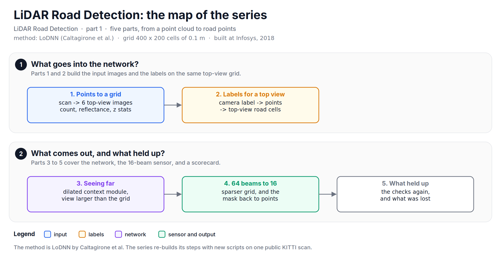
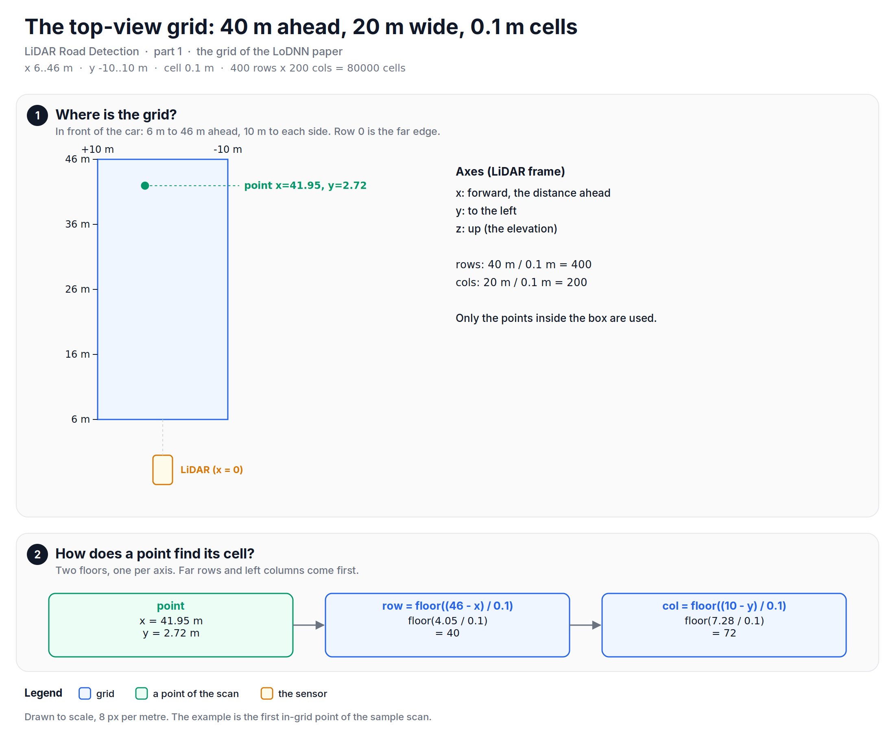
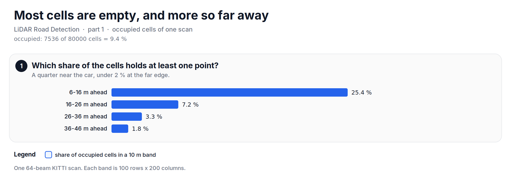

A LiDAR point cloud is an unordered set of points, and a convolution needs an image. This note is about the first step of finding the road in a point cloud: how the points become a set of images, before any neural network. It starts a series.

In 2018, I worked on the road detection module of an autonomous golf cart at Infosys. The module found the drivable road in the point cloud of a LiDAR, and the cart used it for path planning. We used a method called LoDNN, by Caltagirone et al. It is their method, not mine, and the [paper][lodnn] is worth a read. What I did was build it, run it on the cart, and make it work with a Velodyne VLP-16, a 16-beam LiDAR. On the cart, the module reached a 94 % F1 score and 95 % average accuracy, and it ran at 83 FPS, which is 12 ms per frame. Infosys also published [a video of the driverless golf cart][yt].

The data from the cart and our TensorFlow port of the network belong to Infosys, so I do not have them. This series rebuilds each step with new scripts on one public scan from the KITTI road dataset, the sample scan in my [lidar-buster][lidar-buster] repo. The grid and the six input images are the same ones we used on the cart.

The series:
1. From points to a top-view grid (this note)
2. Labels for a top view
3. Seeing far with dilated convolutions
4. From 64 beams to 16, and back to points
5. What held up

*Figure: the map of the series. Parts 1 and 2 prepare the data, parts 3 to 5 use it.*

## Before diving in, what is in a scan?
A LiDAR scan is a list of points. Each point has a position $(x, y, z)$ in metres and a reflectance, which tells how much of the laser light came back. In the LiDAR frame, $x$ points forward, $y$ to the left and $z$ up. I wrote about these axes in [LiDAR Basics - The Coordinate System][kaizen-coords], and about why LiDAR matters in [Why you should be interested in LiDAR technologies?][kaizen-tech].

The sample scan has 116044 points, and the reflectance goes from 0.00 to 0.99. The points have no order that a convolution can use. A camera image has a pixel at every row and column; a point cloud has points wherever the laser hit something.

## Why a top view?
LoDNN does not work on the points. It draws them from above, as images. There are two good reasons in the paper. First, the car plans its path on the ground, in 2D, so a top view is the space where the answer is used. Second, in a top view a patch of the image covers the same area of ground near the car and far away. A camera image is the other way round: a road far away is a few pixels, and the same road near the car is half the image.

## Where is the grid?
The grid covers the area in front of the car: 6 m to 46 m ahead and 10 m to each side. These are the limits of the KITTI road benchmark. The cells are squares of 0.1 m. That gives

$$
\frac{46 - 6}{0.1} = 400 \text{ rows}, \quad \frac{10 - (-10)}{0.1} = 200 \text{ columns}, \quad 400 \times 200 = 80000 \text{ cells}
$$

A point goes to a cell with one floor per axis. Row 0 is the far edge and column 0 is the left edge:

$$
row = \left\lfloor \frac{46 - x}{0.1} \right\rfloor, \quad col = \left\lfloor \frac{10 - y}{0.1} \right\rfloor
$$

Let's say a point is at $x = 41.95$, $y = 2.72$. Its row is $\lfloor 4.05 / 0.1 \rfloor = 40$ and its column is $\lfloor 7.28 / 0.1 \rfloor = 72$. Of the 116044 points, 15515 fall inside the grid, which is 13.4 % of the scan. The rest are behind the car, to the sides, or farther than 46 m.

*Figure: the grid is 40 m by 20 m in front of the car, in cells of 0.1 m. One floor per axis finds the cell of a point.*

## Six images from one scan
For every cell, LoDNN computes six simple statistics of the points in it: the number of points, the mean reflectance, and the max, min, mean and standard deviation of the elevation $z$. Each statistic becomes one 400 x 200 image, and the six images are stacked like the colour channels of a photo. A cell with no point is 0 in all six images.

For a cell with points $z_1, \dots, z_n$, the standard deviation comes from two sums, so it needs no second pass:

$$
\sigma = \sqrt{\frac{1}{n}\sum z_i^2 - \left(\frac{1}{n}\sum z_i\right)^2}
$$

*Figure: the six images of the sample scan. These six images are the whole input of the network.*

## How do six images come from one pass?
A loop over 15515 points works, but NumPy can do it in a few calls. Give every point one flat cell index, `row * 200 + col`. Then `np.bincount` counts the points per index, and with `weights` it also sums the reflectance, $z$ and $z^2$ per index. Means come from sums divided by counts. For the max and the min there is no bincount, so `np.maximum.at` and `np.minimum.at` do the same group-by.

There is a trap here. The obvious line, `grid[row, col] += 1`, does not count. When two points fall in the same cell, NumPy writes that cell once, not twice. I ran into this and [asked about it on Stack Overflow][so-question]. In the sample scan, 4078 cells hold more than one point. The naive line counts 7536 points, one per occupied cell, while `np.add.at` counts all 15515.

![Two panels. 1: 15515 points get a flat index row * 200 + col from 0 to 79999, then bincount, maximum.at and minimum.at group them by cell. 2: 4078 cells hold more than one point; grid[row, col] += 1 counts 7536 points, np.add.at counts 15515.](https://raw.githubusercontent.com/mrtpk/kaizen/master/learnings/20261108_lidar_road_detection_1/resources/fig2_scatter_to_grid.png)
*Figure: one flat index per point turns the six images into group-by sums. Fancy-index assignment loses the repeated cells.*

Let's look at the code. It downloads the sample scan, puts it on the grid, and checks the trap:


import urllib.request
import numpy as np

URL = ("https://raw.githubusercontent.com/mrtpk/lidar-buster/"
       "1bb1d59d2d470af4c08350cbd912081728cd01eb/tutorial/sample_data/umm_000015.bin")
urllib.request.urlretrieve(URL, "umm_000015.bin")
p = np.fromfile("umm_000015.bin", dtype=np.float32).reshape(-1, 4).astype(np.float64)   # x, y, z, reflectance

x, y = p[:, 0], p[:, 1]
keep = (x > 6) & (x <= 46) & (y > -10) & (y <= 10)
row = np.floor((46 - x[keep]) / 0.1).astype(int)
col = np.floor((10 - y[keep]) / 0.1).astype(int)
flat = row * 200 + col

count = np.bincount(flat, minlength=400 * 200)          # number of points per cell
max_z = np.full(400 * 200, -np.inf)
np.maximum.at(max_z, flat, p[keep, 2])                  # max elevation per cell

naive = np.zeros(400 * 200)
naive[flat] += 1                                         # repeated cells are written once
print("Points in the grid:", keep.sum())                                  # 15515
print("Naive += loses points. Is pass?", naive.sum() < count.sum())       # True


The full script computes all six images, and checks them against a plain Python loop over the cells. They match, with a largest difference of 5.23e-13 in the standard deviation.

## How sparse is the grid?
Very. Only 7536 of the 80000 cells hold a point, which is 9.4 %. The most points in one cell is 19. And the grid gets emptier with distance: 25.4 % of the cells are occupied from 6 m to 16 m, 7.2 % from 16 m to 26 m, 3.3 % from 26 m to 36 m and only 1.8 % from 36 m to 46 m. This is the nature of a spinning LiDAR. Its beams spread out with distance, so the rings on the ground get farther apart.

*Figure: the share of occupied cells drops fast with distance. Part 3 shows how the network handles this, and part 4 what happens with 16 beams.*

## What the reference does
Our grid and our six images are the ones in the LoDNN paper: the same area, the same 0.1 m cells and the same statistics. The paper calls the reflectance "reflectivity". On the cart, the grid and the six images stayed the same with the VLP-16.

## A small gap
An empty cell is 0 in every image, and a cell whose points sit at $z = 0$ also has a mean elevation near 0. In the sample scan, 5 occupied cells have a mean elevation within 0.05 m of 0. The number-of-points image tells the two cases apart, so the network has the information. A cleaner encoding would mark empty cells with a value that a real cell cannot have.

So, in short: LoDNN turns a scan into six 400 x 200 images, one statistic per image, on a grid of 0.1 m cells in front of the car. One flat index per point and a few group-by calls build all six, and `np.add.at`, not `+=`, is the safe way to add up repeated cells.

The full script is available [here][script].

In part 2, we will see where the labels come from: the road is drawn on the camera image, and we need it on this grid.

**Reference:**
+ [Fast LIDAR-based Road Detection Using Fully Convolutional Neural Networks (Caltagirone et al.)][lodnn]
+ [lidar-buster: Python snippets for LiDAR point clouds (the version used here)][lidar-buster]
+ [Infosys: Autonomous technologies][infosys]
+ [Infosys' Driverless Golf Cart (video)][yt]
+ [Why you should be interested in LiDAR technologies?][kaizen-tech]
+ [LiDAR Basics - The Coordinate System][kaizen-coords]
+ [NumPy grouping/binning values based on associations (Stack Overflow)][so-question]

[script]: https://github.com/mrtpk/kaizen/tree/master/learnings/20261108_lidar_road_detection_1
[lodnn]: https://arxiv.org/abs/1703.03613v2
[lidar-buster]: https://github.com/mrtpk/lidar-buster/tree/1bb1d59d2d470af4c08350cbd912081728cd01eb
[infosys]: https://www.infosys.com/insights/ai-automation/Pages/autonomous-technologies.aspx
[yt]: https://www.youtube.com/watch?v=X6wEztubV_4
[kaizen-tech]: https://www.thomaspaul.dev/2018/08/201808lidar-tech.html
[kaizen-coords]: https://www.thomaspaul.dev/2018/08/201808lidar-coordinates.html
[so-question]: https://stackoverflow.com/questions/51691980/numpy-grouping-binning-values-based-on-associations
