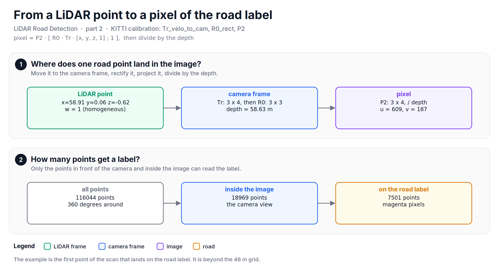
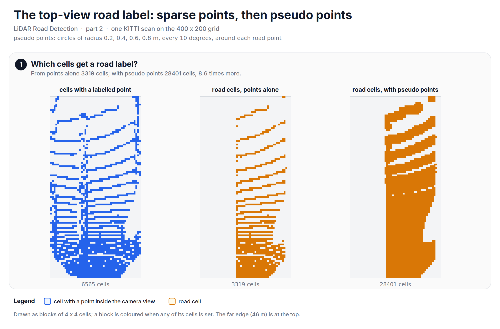
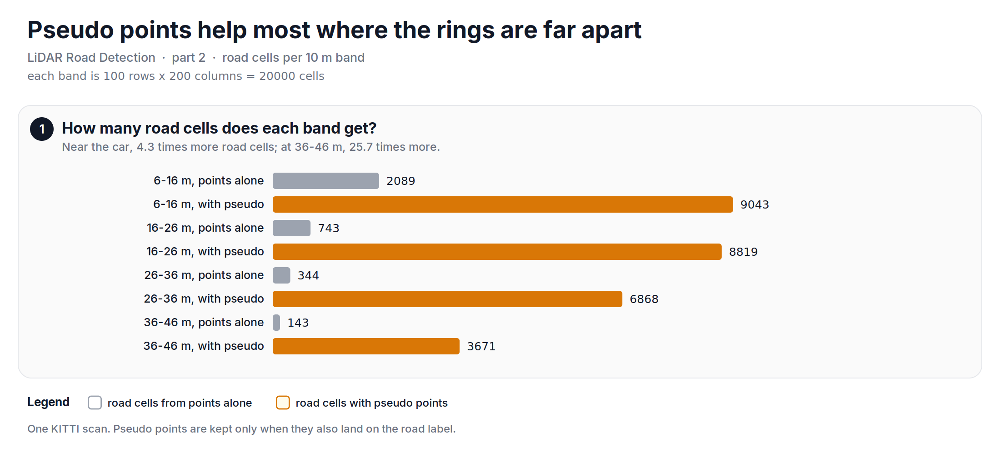

Lately, I have been going through my notes from a LiDAR road detection project at Infosys, and this note is about labels: where the "road" answer for each cell of the grid comes from.

In [part 1][prev], we turned one LiDAR scan into six 400 x 200 images on a top-view grid of 0.1 m cells. To train a network on those images, we need a label image on the same grid: road or not road, cell by cell. The KITTI road dataset has labels, but they are drawn on the camera image, not on the grid. This part moves them over.

## Before diving in, what does a KITTI road label look like?
It is a colour image of the same size as the camera image, 1242 x 375 pixels. Road pixels are magenta and the other pixels are red. In our sample scan, 22.6 % of the label image is road. The label is drawn in perspective: the road near the car is a wide area at the bottom of the image, and the road far away is a thin strip near the horizon.

## Two ways to bring the label down
The first way is to warp the label image to a top view, with an inverse perspective mapping (IPM). IPM assumes that everything in the image lies on a flat road. That is rarely true, so a car or a curb in the image is stretched onto the ground, and the warped label shows road where there is none.

The second way, which the LoDNN paper uses, starts from the points. Each LiDAR point is projected into the camera image, it reads the label under it, and then it goes to the grid with that label. A point on the back of a car lands on a red pixel, so the car is "not road" in the top view as well. No flat-ground assumption is needed.

## Where does a point land in the image?
KITTI gives three calibration matrices for each scan: `Tr_velo_to_cam` (3 x 4) moves a point from the LiDAR frame to the camera frame, `R0_rect` (3 x 3) rectifies it, and `P2` (3 x 4) projects it onto the image of the left colour camera. With the point in homogeneous coordinates:

$$
\begin{bmatrix} u' \\ v' \\ d \end{bmatrix} = P_2 \begin{bmatrix} R_0 \, T \begin{bmatrix} x \\ y \\ z \\ 1 \end{bmatrix} \\ 1 \end{bmatrix}, \qquad u = \left\lfloor \frac{u'}{d} \right\rfloor, \quad v = \left\lfloor \frac{v'}{d} \right\rfloor
$$

Here $d$ is the depth of the point in front of the camera. Let's say a point is at $x = 58.91$, $y = 0.06$, $z = -0.62$. It lands on pixel $u = 609$, $v = 187$, at a depth of 58.63 m, and that pixel is magenta: it is a road point.

The camera sees only what is in front of it, so only part of the scan can read a label. Of the 116044 points, 18969 land inside the image, and 7501 of them land on the road.

*Figure: one point from the LiDAR frame to a pixel of the label, and how many points of the scan get a label.*

## A sparse label
Now each labelled point goes to its grid cell, as in part 1. On the grid, 6565 cells hold a point that has a label, and 3319 of them hold a road point. That is a label, but a poor one: it has the same ring pattern as the scan. Between two rings, the cells are empty, and the network cannot learn "road" from a cell with no label.

## Pseudo points on circles
The paper fills the gaps by interpolating the point cloud in narrow circular sectors before the projection. In [lidar-buster][lidar-buster], I wrote this step as circles of pseudo points around each road point: radii of 0.2, 0.4, 0.6 and 0.8 m, every 10 degrees. That is 4 x 36 = 144 pseudo points per road point. Each pseudo point keeps the height and the reflectance of its road point.

A pseudo point can fall off the road, for example next to a curb. So each pseudo point is projected into the image as well, and it is kept only when it also lands on the road label. From 7501 road points, we make 1080144 pseudo points, and 1009548 of them land on the road, which is 93.5 %. With them, the grid has 28401 road cells instead of 3319, 8.6 times more.

Let's look at the code. This is the circle generator, with a check that it makes 144 points within 0.8 m:


import numpy as np

def ring_points(point, r=1.0, dr=0.2, dphi=10.0):
    """Pseudo points on circles around one road point (same z and reflectance)."""
    phi = np.radians(np.arange(0.0, 360.0, dphi))       # 36 directions
    radii = np.arange(dr, r, dr)                         # 0.2, 0.4, 0.6, 0.8 m
    rr, pp = np.meshgrid(radii, phi)
    out = np.repeat(point[None, :], rr.size, axis=0).astype(np.float64)
    out[:, 0] += (rr * np.cos(pp)).ravel()
    out[:, 1] += (rr * np.sin(pp)).ravel()
    return out

seed = np.array([20.0, 1.5, -1.7, 0.3])                  # x, y, z, reflectance
pseudo = ring_points(seed)
dist = np.hypot(pseudo[:, 0] - seed[0], pseudo[:, 1] - seed[1])
print("Pseudo points:", len(pseudo))                                         # 144
print("All within 0.8 m and at the same height. Is pass?",
      bool(np.all(dist <= 0.8 + 1e-9) and np.all(pseudo[:, 2] == seed[2])))  # True


*Figure: the road label on the grid. Points alone give rings; pseudo points fill the space between them.*

The full script checks that the pseudo points only add road: every road cell of the sparse label is still road in the dense label.

## Where do the pseudo points help?
Far away. The rings are close together near the car and far apart at the far edge, so that is where the gaps are. From 6 m to 16 m, the pseudo points give 4.3 times more road cells (2089 to 9043). From 36 m to 46 m, they give 25.7 times more (143 to 3671).

*Figure: road cells per 10 m band. The farther the band, the more the pseudo points add.*

## What the reference does
The paper interpolates the points linearly inside narrow circular sectors, and then projects them. Our circles around each road point are a simpler version of the same idea: make the cloud denser, but let the camera label decide what is road. The paper also compares this label with an IPM label on its validation set, and the point-projection label scores higher. Both ways, the label comes from the camera, so the top view can only be as good as the camera label.

## Gaps
A pseudo point keeps the height of its road point. The height goes into the projection, so a wrong height moves the pseudo point a little in the image, and at the edge of the road that can change whether it lands on road. The pseudo points that land off the road label are dropped, so the label does not spread beyond the road of the camera label. What the circles cannot fix is a cell that no point is near: beyond the last ring, there is nothing to grow from.

So, in short: the road label is drawn on the camera image, so we project every LiDAR point into the image to read it, and then put the points on the grid. Circles of pseudo points around each road point, kept only when they land on the road, turn a label of rings into a filled road area.

The full script is available [here][script].

In part 3, we will look at the network that takes the six images and gives a road map back, and at how it sees far across the 40 m grid with only one pooling step.

**Reference:**
+ [Fast LIDAR-based Road Detection Using Fully Convolutional Neural Networks (Caltagirone et al.)][lodnn]
+ [lidar-buster: Python snippets for LiDAR point clouds (the version used here)][lidar-buster]
+ [Infosys: Autonomous technologies][infosys]
+ [Infosys' Driverless Golf Cart (video)][yt]
+ [Why you should be interested in LiDAR technologies?][kaizen-tech]
+ [LiDAR Basics - The Coordinate System][kaizen-coords]

[prev]: https://github.com/mrtpk/kaizen/tree/master/learnings/20261108_lidar_road_detection_1
[script]: https://github.com/mrtpk/kaizen/tree/master/learnings/20261108_lidar_road_detection_2
[lodnn]: https://arxiv.org/abs/1703.03613v2
[lidar-buster]: https://github.com/mrtpk/lidar-buster/tree/1bb1d59d2d470af4c08350cbd912081728cd01eb
[infosys]: https://www.infosys.com/insights/ai-automation/Pages/autonomous-technologies.aspx
[yt]: https://www.youtube.com/watch?v=X6wEztubV_4
[kaizen-tech]: https://github.com/mrtpk/kaizen/tree/master/learnings/20180827_lidar_tech
[kaizen-coords]: https://github.com/mrtpk/kaizen/tree/master/learnings/20180929_lidar-coordinate-basics
