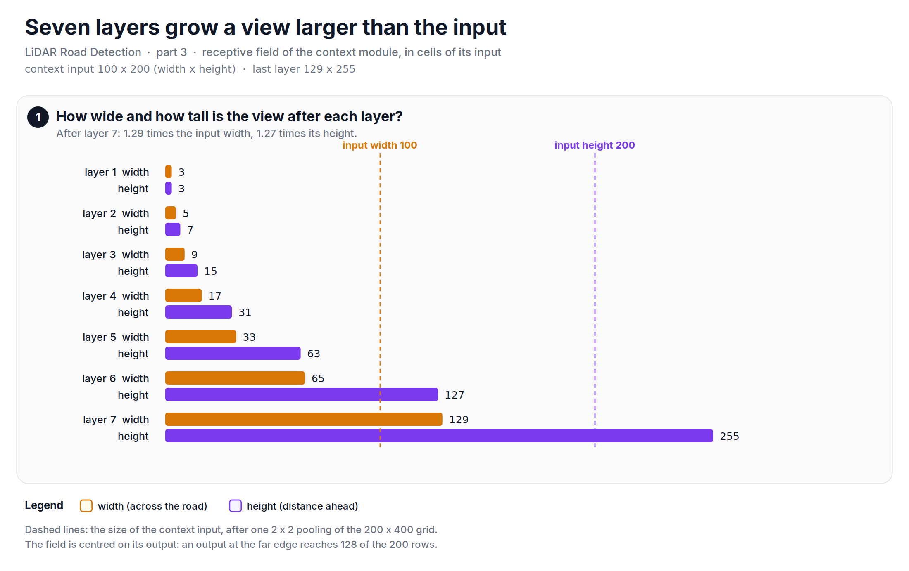
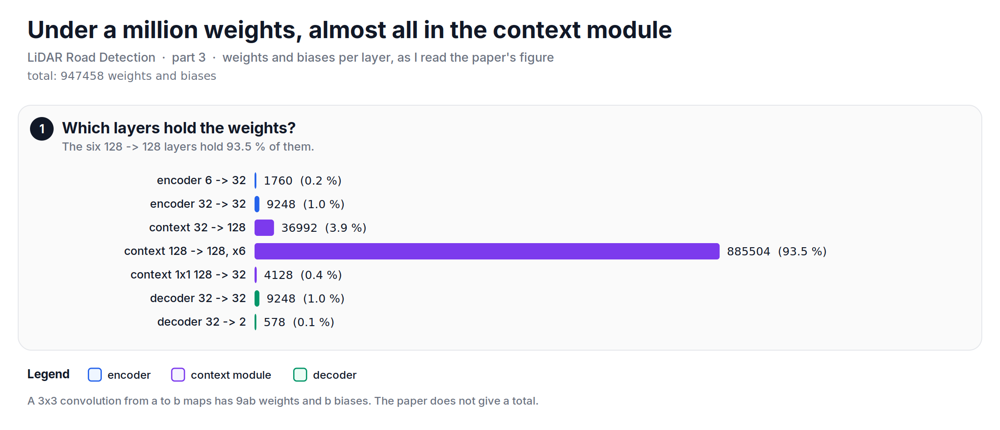

To label a cell 40 m ahead, a network must see a large area around it. This note is about how LoDNN does that across a 40 m grid with only one pooling step.

In [part 1][prev1], we turned a scan into six 400 x 200 images, and in [part 2][prev], we made a road label on the same grid. Now the network has to map six images to one road map. The network is LoDNN, by Caltagirone et al., and this part follows their paper. Our TensorFlow port from the golf cart belongs to Infosys and I do not have it, so I cannot show its layers here.

## Before diving in, what is a receptive field?
The receptive field of a layer is the area of the input that one of its outputs can see. One 3x3 convolution sees 3 x 3 cells. Two 3x3 convolutions in a row see 5 x 5, three see 7 x 7: each layer adds 2 cells in each direction.

That is slow. The grid is 400 cells tall, and the road at the far edge has to be judged from what is around it, because the far grid is almost empty (part 1). With plain 3x3 layers, a view 255 cells tall needs 127 layers.

The usual answer is pooling: shrink the image, so each cell covers more ground. But each pooling also throws away resolution, and the network must give a road label for every 0.1 m cell. LoDNN pools only once, and uses dilated convolutions for the rest.

## What is a dilated convolution?
A dilated convolution is a 3x3 convolution with gaps between its taps. With a dilation of 2, the nine taps are 2 cells apart, and they cover 5 x 5 cells with the same nine weights. With a dilation of $d$, a 3x3 layer adds $2d$ cells to the receptive field instead of 2:

$$
RF_{n} = RF_{n-1} + 2 d_n, \qquad RF_0 = 1
$$

If each layer doubles $d$, the receptive field roughly doubles with each layer, and the number of weights grows only by one layer's worth.

## The three blocks
The paper's network has three blocks:

1. **Encoder.** Two 3x3 convolutions with 32 maps (the kernel size is my reading of the paper's figure), then one 2 x 2 max pooling. The 200 x 400 grid (width x height) becomes 100 x 200.
2. **Context module.** Seven dilated 3x3 convolutions with 128 maps, each followed by an ELU and spatial dropout, then a 1x1 convolution back to 32 maps.
3. **Decoder.** A max unpooling back to 200 x 400, using the positions from the pooling, then two convolutions down to 2 maps, road and not road, and a softmax.

The output is a road confidence map: for every cell of the grid, the probability that it is road.

*Figure: LoDNN as three blocks. The context module does the looking; the encoder and the decoder only change the resolution.*

## How far does the context module see?
The dilations of the seven context layers, as (width, height), are (1, 1), (1, 2), (2, 4), (4, 8), (8, 16), (16, 32) and (32, 64). With the formula above, the receptive field grows as 3 x 3, 5 x 7, 9 x 15, 17 x 31, 33 x 63, 65 x 127 and 129 x 255. These are the numbers in the paper's table, and the script re-computes them.

A formula is easy to get wrong, so the script also checks it the long way: it puts a single 1 in an empty image, runs it through the seven dilated convolutions with all-ones weights, and measures how far the 1 has spread. It reaches 129 x 255 cells, the same as the table.

Let's look at the code:


import numpy as np

DILATIONS = [(1, 1), (1, 2), (2, 4), (4, 8), (8, 16), (16, 32), (32, 64)]   # (width, height)

def dilated_ones(x, dw, dh):
    """3x3 convolution, all-ones weights, dilation (dw, dh), zero padding."""
    out = np.zeros_like(x)
    H, W = x.shape
    for i in (-1, 0, 1):
        for j in (-1, 0, 1):
            si, sj = i * dh, j * dw
            src = x[max(0, si):H + min(0, si), max(0, sj):W + min(0, sj)]
            out[max(0, -si):H + min(0, -si), max(0, -sj):W + min(0, -sj)] += src
    return out

w = h = 1
for dw, dh in DILATIONS:                     # RF_n = RF_(n-1) + 2 d_n
    w, h = w + 2 * dw, h + 2 * dh

x = np.zeros((h + 41, w + 41))
x[x.shape[0] // 2, x.shape[1] // 2] = 1.0   # one impulse
for dw, dh in DILATIONS:
    x = dilated_ones(x, dw, dh)
rows, cols = np.nonzero(x)
reach = (int(cols.max() - cols.min() + 1), int(rows.max() - rows.min() + 1))
print("Receptive field:", (w, h))                                   # (129, 255)
print("Impulse matches the formula. Is pass?", reach == (w, h))    # True


## Does it see the whole grid?
Its receptive field is larger than the grid, but not every output sees all of it. The context module works on the pooled 100 x 200 image, and its last layer has a receptive field of 129 x 255 cells: 1.29 times the width and 1.27 times the height of its input. The paper says the same: the receptive field is larger than the input feature maps.

But a receptive field is centred on its output. An output at the far edge of the context input reaches 128 of the 200 rows, not all of them.

*Figure: the receptive field after each layer. Layer 7 is larger than its input in both width and height; an output at the edge still sees only part of it.*

In cells of the original grid, with the encoder and the decoder added, the receptive field of the whole network is 266 x 518 cells, which is 26.6 m x 51.8 m. The grid is 20 m x 40 m. One output reaches 258 cells ahead and behind, and 132 cells to each side. So the outputs near the middle, rows 141 to 258 and columns 67 to 132, see the whole grid; that is 9.7 % of the cells. An output at the far edge sees rows 0 to 258, which is 64.8 % of the distance ahead. Every output sees far, but only the middle sees everything.

## Why is the height dilation twice the width?
Because the grid is twice as tall as it is wide. From layer 2 on, the height dilation is 2.0 times the width dilation in every layer, so the view grows in the same 1:2 shape as the grid. The paper's table says it this way: the receptive field grows at different rates in width and height, matching the 1:2 aspect ratio of the input images.

## How many weights?
The paper gives the shapes of the blocks but not a total, so I counted them from my reading of its figure. A 3x3 convolution from $a$ to $b$ maps has $9ab$ weights and $b$ biases. In total, I get 947458 weights and biases, under a million. The six 128 to 128 context layers hold 93.5 % of them; the encoder and the decoder together hold 2.2 %.

*Figure: almost all the weights are in the context module, where the dilated convolutions work at 128 maps.*

On the golf cart, our module ran at 12 ms per frame, which is 83 FPS.

## What the reference does
This whole part is the reference: the blocks, the dilation table and the receptive fields are from the LoDNN paper. The paper trains the network from scratch, without a pretrained encoder, because top-view LiDAR images do not look like the photos that pretrained encoders are made for. It also chose one pooling and dilated convolutions on purpose, to keep both a large receptive field and high-resolution feature maps.

## Gaps
Two numbers here depend on my reading of the paper's figure: the kernel sizes outside the dilation table, which I took as 3x3, and so the total of 947458 weights. The receptive field of the context module does not depend on that reading; it comes from the table alone. Also, a receptive field is only the area an output can see. How much the network uses the far cells is a question for training, which this series does not repeat.

So, in short: LoDNN pools once and then uses seven dilated convolutions whose dilation doubles, with twice the reach in height as in width. That gives a receptive field larger than the 40 m grid with under a million weights, and the outputs near the middle see all of it.

The full script is available [here][script].

In part 4, we will swap the 64-beam sensor of KITTI for 16 beams, see what that does to the grid, and take the road map back to the points.

**Reference:**
+ [Fast LIDAR-based Road Detection Using Fully Convolutional Neural Networks (Caltagirone et al.)][lodnn]
+ [lidar-buster: Python snippets for LiDAR point clouds (the version used here)][lidar-buster]
+ [Infosys: Autonomous technologies][infosys]
+ [Infosys' Driverless Golf Cart (video)][yt]
+ [Why you should be interested in LiDAR technologies?][kaizen-tech]
+ [LiDAR Basics - The Coordinate System][kaizen-coords]

[prev1]: https://www.thomaspaul.dev/2026/11/202611lidar-road-detection-1-from-points-to-a-top-view-grid.html
[prev]: https://www.thomaspaul.dev/2026/11/202611lidar-road-detection-2-labels-for-a-top-view.html
[script]: https://github.com/mrtpk/kaizen/tree/master/learnings/20261108_lidar_road_detection_3
[lodnn]: https://arxiv.org/abs/1703.03613v2
[lidar-buster]: https://github.com/mrtpk/lidar-buster/tree/1bb1d59d2d470af4c08350cbd912081728cd01eb
[infosys]: https://www.infosys.com/insights/ai-automation/Pages/autonomous-technologies.aspx
[yt]: https://www.youtube.com/watch?v=X6wEztubV_4
[kaizen-tech]: https://www.thomaspaul.dev/2018/08/201808lidar-tech.html
[kaizen-coords]: https://www.thomaspaul.dev/2018/08/201808lidar-coordinates.html
