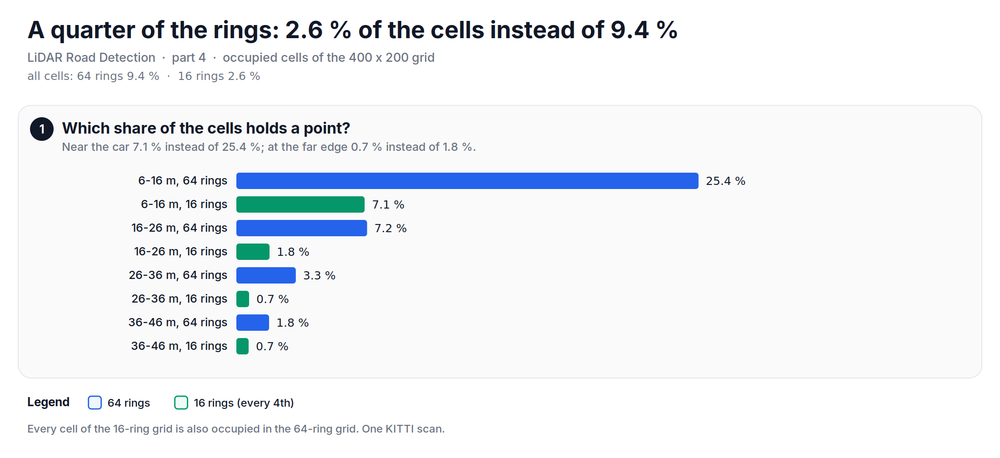
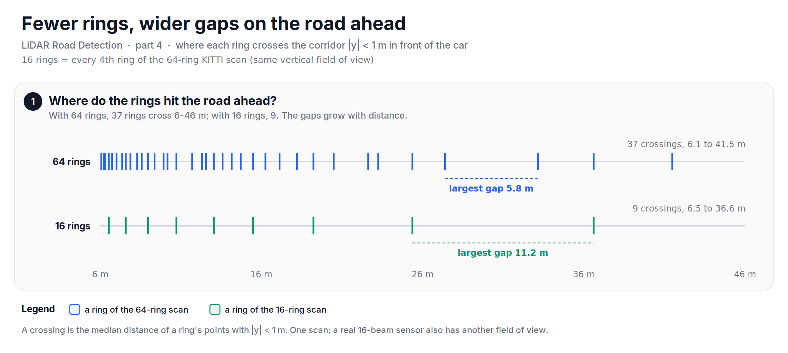

KITTI uses a LiDAR with 64 beams, but the golf cart at Infosys had one with only 16. This note is about what that change does to the grid, and about the last step of the pipeline.

In [part 3][prev], we saw how LoDNN looks far across the 400 x 200 grid with one pooling step and seven dilated convolutions. Everything so far used a KITTI scan, from a 64-beam sensor. On the cart, we used a Velodyne VLP-16, which has 16. This part looks at what a quarter of the beams does to the grid, and then at the last step of the pipeline: from the road map back to the points.

## Before diving in, what is a beam?
A spinning LiDAR has a vertical stack of lasers. Each laser points at a fixed angle up or down, and as the sensor spins, it traces one ring around the car. A 64-beam sensor traces 64 rings per turn; a 16-beam sensor traces 16.

The sample scan stores its points ring by ring, and each ring goes once around the car. So a new ring starts wherever the azimuth (the angle around the car) jumps by a full turn. The first and the last piece of the scan are the same ring, cut where the recording started. With that, the scan splits into 64 rings, from 2.2 degrees up to 23.3 degrees down, about 0.40 degrees apart.

## Emulating 16 beams
I do not have the VLP-16 data; it stayed with Infosys. But we can get a 16-ring scan from the 64-ring one: keep every 4th ring. That gives 16 rings over the same vertical field of view, and 29314 of the 116044 points, which is 25.3 %. A real VLP-16 has its own field of view and beam angles, so this is a sketch of the effect, not a copy of the sensor.

Let's look at the code. It splits the sample scan into rings and keeps every 4th one:


import urllib.request
import numpy as np

URL = ("https://raw.githubusercontent.com/mrtpk/lidar-buster/"
       "1bb1d59d2d470af4c08350cbd912081728cd01eb/tutorial/sample_data/umm_000015.bin")
urllib.request.urlretrieve(URL, "umm_000015.bin")
p = np.fromfile("umm_000015.bin", dtype=np.float32).reshape(-1, 4)

az = np.degrees(np.arctan2(p[:, 1], p[:, 0]))             # angle around the car
ring = np.r_[0, np.cumsum(np.abs(np.diff(az)) > 180)]       # a jump of a full turn starts a ring
ring[ring == ring.max()] = 0                                 # the last piece is the first ring
p16 = p[ring % 4 == 0]                                       # every 4th ring

print("Rings:", ring.max() + 1, " points kept:", len(p16))                 # 64, 29314
print("16 rings kept. Is pass?", len(np.unique(ring[ring % 4 == 0])) == 16)  # True


## What does the grid lose?
The grid now gets 3903 points instead of 15515. The share of occupied cells drops from 9.4 % to 2.6 %. Near the car, from 6 m to 16 m, it drops from 25.4 % to 7.1 %; at the far edge, from 36 m to 46 m, from 1.8 % to 0.7 %. Every cell that the 16-ring scan fills is also filled by the 64-ring scan, so we only lose information; nothing moves.

*Figure: the share of occupied cells per 10 m band, with 64 rings and with every 4th ring.*

The road ahead shows it more clearly. Take a 2 m wide corridor straight in front of the car, and mark where each ring crosses it. With 64 rings, 37 rings cross it between 6 m and 46 m, from 6.1 m to 41.5 m, and the largest gap between two rings is 5.8 m. With 16 rings, only 9 rings cross it, from 6.5 m to 36.6 m, and the largest gap is 11.2 m. Beyond 36.6 m, no ring of the 16-ring scan crosses the road ahead.

*Figure: where the rings cross the road ahead. With 16 rings, the largest gap on the road grows from 5.8 m to 11.2 m.*

The six images do not change with the sensor: they are statistics per cell, and an empty cell is simply 0. The wide receptive field of part 3 can, in principle, judge a cell between two rings from the rings around it; this series does not train a network, so it does not test that. On the cart, we kept the same grid and the same six images with the VLP-16.

## Back to points
The network gives a road map: for every cell, the probability that it is road. In our pipeline, the road map then labelled the points of the scan, and the road points could be drawn on the camera image. A road map on a grid is easy to turn back into points. Each point already knows its cell (part 1), so its label is the value of the road map in that cell:

$$
label(p) = road\_map[\,row(p),\ col(p)\,]
$$

The road points can then be projected onto the camera image, as in part 2, to show the result to a person.

How much does the grid step lose? Without a trained network, I can test only the lookup, so I use the dense label of part 2 as the road map. Of the 16-ring scan, 3321 points are both in the grid and in the camera image. The lookup calls 2066 of them road; the camera label calls 1914 of them road. The two agree for 95.4 % of the points. All 152 disagreements go one way: the lookup calls the point road, and the camera label does not. So the grid label is a little wider than the road. That fits how it was made: the pseudo points of part 2 reach up to 0.8 m from a road point, and a road cell can also hold a point that is not on the road.

*Figure: the last step of the pipeline, and how well a grid label agrees with the label of each point.*

## How did it do on the cart?
On the golf cart, with the VLP-16, the road detection module reached a 94 % F1 score and 95 % average accuracy. It ran at 83 FPS, which is 12 ms per frame; as a check, 1000 / 12 = 83.3. The data and our TensorFlow port stayed with Infosys, so I cannot re-run these numbers here, and the scripts of this series do not reproduce them.

## What the reference does
The LoDNN paper works with the 64-beam KITTI scans only; it has no experiment with fewer beams. It does test smaller regions of the grid, and the network does better when the far part of the grid is left out, where the points are sparse. A 16-beam sensor makes the whole grid look more like that far part.

## Gaps
The 16-ring scan here is an emulation from one KITTI scan: the same vertical field of view, with every 4th ring. It shows the trend, not the numbers of a real VLP-16. And the 95.4 % agreement measures only the grid step, with a perfect road map; a trained network adds its own errors on top.

So, in short: a quarter of the beams leaves a quarter of the occupied cells, and gaps of more than 11 m on the road ahead. LoDNN's per-cell images do not depend on the number of beams, and a simple cell lookup takes the road map back to the points.

The full script is available [here][script].

In part 5, we will run all the checks of the series again, and look at what held up.

**Reference:**
+ [Fast LIDAR-based Road Detection Using Fully Convolutional Neural Networks (Caltagirone et al.)][lodnn]
+ [lidar-buster: Python snippets for LiDAR point clouds (the version used here)][lidar-buster]
+ [Infosys: Autonomous technologies][infosys]
+ [Infosys' Driverless Golf Cart (video)][yt]
+ [Why you should be interested in LiDAR technologies?][kaizen-tech]
+ [LiDAR Basics - The Coordinate System][kaizen-coords]

[prev]: https://www.thomaspaul.dev/2026/11/202611lidar-road-detection-3-seeing-far-with-dilated-convolutions.html
[script]: https://github.com/mrtpk/kaizen/tree/master/learnings/20261108_lidar_road_detection_4
[lodnn]: https://arxiv.org/abs/1703.03613v2
[lidar-buster]: https://github.com/mrtpk/lidar-buster/tree/1bb1d59d2d470af4c08350cbd912081728cd01eb
[infosys]: https://www.infosys.com/insights/ai-automation/Pages/autonomous-technologies.aspx
[yt]: https://www.youtube.com/watch?v=X6wEztubV_4
[kaizen-tech]: https://www.thomaspaul.dev/2018/08/201808lidar-tech.html
[kaizen-coords]: https://www.thomaspaul.dev/2018/08/201808lidar-coordinates.html
