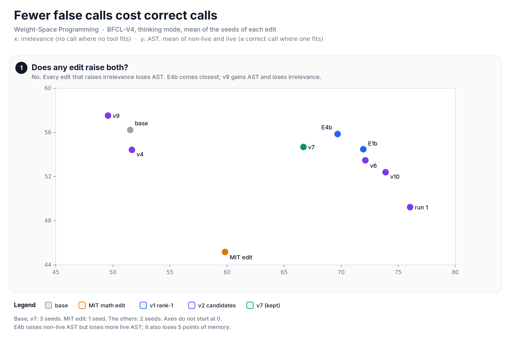

Can a weight edit make a small language model better at calling tools? This is my second weight-space programming experiment. In the [first note][eel], I edited an eel detector. This time the model is Qwen3.5-0.8B, and the test is BFCL-V4, a benchmark for function calling. The goal I set was a BFCL score of 60, from a base of about 20, by editing weights only.

The short answer: the goal was out of reach, and a ten-line calculation shows that before the first edit. The edits did work on one thing, the decision "call a tool or answer in text". Two very different edits each moved the overall score by +0.66 to +2.61 points, and neither one is better in both modes of the model.

Two agents did the work. In v1, Cursor fitted a rank-1 edit. In v2, Claude programmed single neurons under a strict protocol. I set the goal and the rules, raised a budget once, stopped one side test, and read the results. The code, the edits, the ledgers and the score tables are in the [wsp-qwen-tools][repo] repository, and the v7 model is on [Hugging Face][hf]. The [index][index] of this series lists all the experiments and the lessons.

## Before diving in, what is weight-space programming?
Weight-space programming means changing a network by reading and writing its weights directly, from an understanding of what each part computes. The term comes from [Sparks of Weight-Space Programming][mit] by Takehi, Teoh, Zhang and Khattab at MIT CSAIL. Their headline result is on the same model as this note: an edit of 131,072 weights of Qwen3.5-0.8B removed a looping bug, and MATH-500 rose from 7.9 % to 48.1 %.

Let's look at the setup.

| Item | Detail |
| --- | --- |
| Model | Qwen3.5-0.8B, 24 layers, hidden size 1024, MLP size 3584 (SwiGLU) |
| Attention | layers 3, 7, 11, 15, 19, 23 full attention; the others Gated DeltaNet |
| Tool call | `<tool_call>` is one token |
| Benchmark | BFCL-V4, single-turn, multi-turn and memory, 5017 entries per run |
| Modes | thinking (a reasoning trace first) and non-thinking |
| Sampling | temperature 1.0, top-p 0.95, top-k 20, presence penalty 1.5 |
| Compute | one RTX 5090 |

Web search needs an API key that I did not set, so it counts as 0. The overall numbers here are therefore not leaderboard numbers.

## How noisy is one run?
The sampling is random, so one run is one draw. The base model in thinking mode gave 20.04, 20.88 and 21.59 on three seeds. That is a spread of 1.55 points, about as large as the gains below.

Both studies used one rule to accept a gain: every seed of the edit must be above every seed of the base. If an edit has no real effect, all the seeds come from one distribution, and the rule passes by chance in $1/\binom{2n}{n}$ of the cases for $n$ seeds against $n$.

Let's look at the code.


from math import comb
import numpy as np

rng = np.random.default_rng(0)
for n in (2, 3, 4):
    x = rng.normal(size=(200_000, 2 * n))   # no real effect
    sim = np.mean(x[:, :n].min(1) > x[:, n:].max(1))
    print(f"{n} vs {n}: 1 in {comb(2 * n, n)}. Is pass?", abs(sim - 1 / comb(2 * n, n)) < 0.003)
# 2 vs 2: 1 in 6. Is pass? True
# 3 vs 3: 1 in 20. Is pass? True
# 4 vs 4: 1 in 70. Is pass? True


With two seeds against two, a useless edit passes once in 6 tries. Most results in this note have two seeds, so I call those passes provisional.

## What fails in the base model?
BFCL-V4 has a fixed formula for the overall score:

$$
\text{overall} = 0.1 \cdot \text{non-live} + 0.1 \cdot \text{live} + 0.1 \cdot \text{irrelevance} + 0.3 \cdot \text{multi-turn} + 0.4 \cdot \text{agentic}
$$

Agentic is the mean of memory and web search. The script rebuilds the overall score of all 39 runs from their parts this way. The largest difference to the reported overall is 0.006.

Here is the base model, with the mean of all seeds:

| Measure | thinking | non-thinking |
| --- | --- | --- |
| Overall | 20.84 | 17.68 |
| Non-live AST | 57.50 | 33.98 |
| Live | 54.95 | 43.89 |
| Multi-turn | 5.54 | 3.44 |
| Memory | 13.90 | 5.48 |
| Irrelevance | 51.52 | 77.72 |

The two modes fail in opposite ways:

+ **Non-thinking mode calls too little.** When a tool fits, it often answers in text instead: 685 and 699 of 2,501 call entries on two seeds. One example from the study log: the prompt gives a tool `algebra.quadratic_roots`, and the model solves the equation in LaTeX.
+ **Thinking mode calls too much.** Irrelevance is the share of prompts with no fitting tool where the model correctly does not call. At 51.52, the model calls a tool for 48.5 % of those prompts.

The other failures are not about this decision. The largest single-turn failure in thinking mode is a wrong argument value: an invented value for an optional parameter, or "Rohnert Park, TX" for a place in California. Multi-turn and memory are near 5 and 14.

## The ceiling I did not calculate
This is the step that I would do first next time. Before any edit, ask: what does a perfect edit give?

A decision edit can help the single-turn parts: non-live, live and irrelevance. In thinking mode, those three give 16.40 of the 20.84 points. Multi-turn gives 1.66 and memory 2.78. Now give the model a perfect single-turn score, 100 in all three:


base = dict(non_live=57.50, live=54.95, irrelevance=51.52, multi_turn=5.54, memory=13.90)

def overall(s):
    return 0.1 * (s["non_live"] + s["live"] + s["irrelevance"]) + 0.3 * s["multi_turn"] + 0.4 * s["memory"] / 2

perfect = dict(base, non_live=100.0, live=100.0, irrelevance=100.0)
print(f"{overall(base):.2f} -> {overall(perfect):.2f}. Is 60 out of reach?", overall(perfect) < 60)
# 20.84 -> 34.44. Is 60 out of reach? True


Even a perfect single-turn model scores 34.44. The goal needs +39.16, and single-turn can add at most +13.60. The rest must come from multi-turn (30 % of the weight) and memory, and those need correct values and state over many steps. The base-model census above was enough to see this. I only saw it at the end.

*Figure: the score parts of the base model in thinking mode, and the ceiling of a perfect single-turn edit.*

## Where does the model decide?
Both agents first read the model before they edited it. The findings logs give the answer:

+ **Non-thinking mode decides at the first assistant token.** The probability of `<tool_call>` there predicts the sampled outcome with an AUROC of 0.914.
+ **Thinking mode decides inside the reasoning.** After `</think>`, the call probability is almost binary (AUROC 0.980). The token mixers of layers 15 to 22 write the decision, and the Gated DeltaNet of layer 22 holds most of the causal effect when it is patched.
+ **A linear read beats the model's own call probability.** In non-thinking mode, an LDA read at the input of the layer-23 MLP reaches an AUROC of 0.947 on held-out ToolACE rows, against 0.839 for the model. The read holds inside one data source, not across sources, and in thinking mode the gap is small.

The last point is the opening for an edit. In non-thinking mode, the information is there, and the model does not use all of it. And layer 23 is the last layer: its MLP output goes to the final norm and the output layer, so an edit there changes the logits directly, with no later layer to undo it.

## v1: one rank-1 edit
Cursor ran v1 over about one day. The edit has one form:

$$
W' = W - k \, u \, \rho^\top
$$

$W$ is the down projection of the layer-23 MLP (1024 × 3584). $\rho$ is a read direction over the 3584 MLP neurons: "this prompt needs no call". $u$ is a write direction in the 1024-d residual that raises the `<tool_call>` logit and moves the common tokens as little as possible. $k$ is the strength.

Without the final norm, the change of the logits is exactly $-k (\rho \cdot h)(U u)$, where $h$ is the MLP activation and $U$ is the output layer. The script checks this on a toy layer, to a maximum error of 4.4e-15. It also shows the catch: a rank-1 change touches every value of the matrix. In Qwen that is 1024 × 3584 = 3,670,016 values. In bf16, 3,533,106 of them change.

The first edit, E1b, fitted the read on the thinking decision token only. Thinking mode rose to 22.80, the best thinking score of both studies. Non-thinking fell to 16.73 (one seed). The edit acts at every position, also where the non-thinking decision happens, and it was never fitted there. Lesson: fit the read on every context that the edit sees.

E4b fixed that. It fitted the read on the decision tokens of both modes, with k = 5:

| Mode | base | E4b | gain | seeds | rule |
| --- | --- | --- | --- | --- | --- |
| thinking | 20.84 | 21.49 | +0.66 | 21.40 / 21.59 | fail |
| non-thinking | 17.68 | 20.29 | +2.61 | 20.02 / 20.56 | pass, 2 vs 2 |

In non-thinking mode, E4b halved the "text instead of a call" failures: 685 / 699 became 332 / 328. Non-live AST went from 33.98 to 49.55. In thinking mode, the higher E4b seed (21.59) only ties the highest base seed, and the lower one (21.40) is below it, so the rule fails.

There is a bigger problem. E4b was fitted on BFCL prompts and activations, so every E4b number is in-sample.

For comparison, the MIT edit, which was made for the math loops, is worse than base on tool use: 19.04 in thinking mode and 15.66 in non-thinking mode, one seed each.

## v2: programming single neurons
For v2, I changed the rules. Claude ran it under the [OpenWSP][openwsp] protocol:

+ No gradients and no training. The editor reads and writes the weights in Python cells.
+ Model outputs come only from forward passes through a service, with a budget of 50 passes per run. I raised it to 100 for run 3, which then used 35.
+ No BFCL data in any fit. Only practice data: [When2Call][when2call], [ToolACE][toolace] and [APIGen-MT-5k][apigen], with glaive function calling as a test set only.

The edit form changed too. Instead of a rank-1 change of a whole matrix, the editor overwrites one unused neuron of the layer-23 MLP. One SwiGLU neuron $j$ has three vectors of 1024 values:

$$
\text{out}_j(x) = \text{silu}(g_j \cdot x)\,(a_j \cdot x)\; d_j
$$

+ The gate row $g_j$ is positive only at decision positions. Everywhere else, silu of a negative value is close to 0, so the neuron is silent.
+ The up row $a_j = r - \theta \, q / c$ holds the decision read $r$ and a threshold $\theta$. Here $q$ is a direction whose value is a constant $c$ at decision positions, so $q / c$ acts as a bias of 1.
+ The down column $d_j = K u$ writes toward `<tool_call>` with strength $K$.

That is 3 × 1024 = 3,072 values per neuron. The neuron fires only where the gate opens, and its sign follows the read minus the threshold.

*Figure: the two edit forms. v7 changes about 600 times fewer values than E4b.*

### Run 1: the read learned the source
The first neuron looked very good on practice data. Then BFCL: non-thinking 17.74 against 17.68, and in `simple_python`, 325 of 400 rows failed with no call (base: 107).

The cause was in the data. Every "no call" row came from When2Call, and every "call" row came from ToolACE. The read learned to tell the two datasets apart, not the decision. BFCL single-call prompts look like When2Call to it, so the neuron pushed "no call".

Let's look at the code. In this toy, the label is the source, and the decision signal is weaker than the style of the source:


import numpy as np

rng = np.random.default_rng(3)
d = 64
need, style = (v / np.linalg.norm(v) for v in rng.normal(size=(2, d)))

def rows(call, src):  # call: needs a call; src: which dataset
    return rng.normal(size=(len(call), d)) + np.outer(0.8 * (2 * call - 1), need) + np.outer(3.0 * (2 * src - 1), style)

def ridge(x, y, lam=3.0):
    xc = x - x.mean(0)
    return np.linalg.solve(xc.T @ xc + lam * np.eye(d), xc.T @ (y - y.mean()))

def auroc(s, y):
    r = s.argsort().argsort() + 1.0
    return (r[y == 1].sum() - (y == 1).sum() * ((y == 1).sum() + 1) / 2) / ((y == 1).sum() * (y == 0).sum())

y = rng.integers(0, 2, 600)
confounded = ridge(rows(y, y), y)                                  # label == source
yc = rng.integers(0, 2, 600)
clean = ridge(rows(yc, np.zeros(600, int)), yc)                    # one source, both labels
yt = rng.integers(0, 2, 600)
test = rows(yt, np.ones(600, int))                                 # one source, both labels
print(f"confounded {auroc(test @ confounded, yt):.3f}, clean {auroc(test @ clean, yt):.3f}")
# confounded 0.627, clean 0.883


The confounded read separates its own data perfectly (AUROC 1.000) and drops to 0.627 when the source no longer gives the answer away. A cross-table of label × source before the fit would have shown it.

Run 2 found a second trap in the same place. With a ridge of λ = 0.01, no read beat the model, and that went into the log as a result. With λ from 1 to 30, the reads beat the model. Tune the regularization before you write down a negative result.

### Run 2: edit v4
With clean reads (call and no-call rows from one source), the neuron 1488 edit v4 gave non-thinking 19.81, with seeds 19.32 and 20.31 above both base seeds. That is the first v2 gain with no BFCL data in the fit. A mode read in the gate kept it almost closed in thinking mode on practice data (on BFCL it is partly active), and thinking stayed at 21.02.

### Run 3: a second neuron for thinking mode
Run 3 added a second neuron for thinking decisions. Its gate must open at "decision AND thinking". The first try added a decision direction and a mode direction. That gate opened at 72 to 91 % of the positions that are not decisions. A sum of two cues is an OR, not an AND.

The fix was a ridge regression without intercept, with target +4 at thinking decisions and −8 at every other kind of position, in both modes. On held-out positions, the smallest value at thinking decisions was 2.58, and the largest value elsewhere was −3.38. The toy in the script shows the same thing: the additive gate is open at 70.3 % of the other positions, and the ridge gate at none of them. In the toy, the ridge gate works only because the positions at thinking decisions carry a direction of their own; without it, no linear gate can make the AND. The study did not test whether the real residual stream has such a direction.

Then four candidates, all scored on BFCL in thinking mode:

| Edit | What changed | thinking | Kept |
| --- | --- | --- | --- |
| v6 | read with call, swap and "text" rows | 22.05 | no: non-live AST 57.50 to 53.11 |
| **v7** | read without the "text" rows | **22.54** | **yes** |
| v9 | v7's thinking neuron refitted with the "text" rows as "call" | 20.96 | no |
| v10 | read with When2Call "ask for a value" rows | 21.99 | no: non-live AST 51.88 |

v6 shows how a "no call" target spreads. The "text" rows taught a refusal. The model then also answered in text on tasks that had a matching tool and all the values. In `simple_python`, the failures with no decodable call rose from 28 in the base to 92 (two seeds, summed): the model wrote worked solutions instead of calls.

v8 and v9 rest on a wrong premise. The agent assumed that the "text" rows were cases where a tool fits and the right answer is text. They were not. Almost all of them were missing-parameter or no-function cases. We did not read them first. v9 pushed them toward a call and lost 1.58 points against v7.

v10 added rows where the model should ask for a missing value, as "no call". On BFCL it failed like v6: the refusal spread to tasks with a matching tool, and in `simple_python` the failures with no call doubled against v7. On the practice set of such rows, it showed one more limit: the model called a tool after a short preamble ("I'll fetch ..."). When the reasoning text already plans a call, a push at the decision token does not stop it.

*Figure: every seed of the main edits against the base seeds. The rule needs the whole edit cloud to the right of the base cloud.*

## v7 against E4b
v7 writes 6,144 values (6,141 of them differ from the base in bfloat16): rows 1488 and 1152 of the gate and up projections, and the same two columns of the down projection. Neuron 1488 acts at non-thinking decisions and neuron 1152 at thinking decisions.

| | E4b (v1) | v7 (v2) |
| --- | --- | --- |
| Agent | Cursor | Claude |
| Changed values | 3,670,016 (rank 1) | 6,144 (two neurons) |
| Fit data | BFCL | practice data only |
| thinking | 21.49 | **22.54** (3 seeds, all above the base) |
| non-thinking | **20.29** | 19.55 |
| mean of the modes | 20.89 | 21.04 |

In thinking mode, every v7 seed is above every E4b seed (+1.05). In non-thinking mode, every E4b seed is above every v7 seed (+0.74 for E4b). The mean of the two modes differs by 0.15, well inside the seed spread. Neither edit is better in both modes.

Against the base in thinking mode, v7 gains +15.2 on irrelevance and +1.8 on multi-turn, and it loses 2.3 on non-live AST. Every edit moved along this one trade-off: fewer false calls against fewer correct calls. In thinking mode, every edit that raises irrelevance loses AST (the mean of non-live and live), and v9, the one edit that gains AST, loses irrelevance. E4b comes closest to a free gain: +18.17 irrelevance for −0.37 AST. It may pay elsewhere: −5.19 on memory, but memory varies by up to 4.3 points between seeds, so that loss is not confirmed.

*Figure: thinking mode. Every edit trades false calls against correct calls; none of them moves up and to the right of the base.*

v7 is also not a clean result. No BFCL row went into a fit, but the BFCL scores chose v7 from four candidates. The third seed came after the choice. It tests the sampling noise, not the choice.

The v7 model is on Hugging Face as [mrtpk/Qwen3.5-0.8B-wsp-tool-use][hf] (branch `v7`). Only the three edited tensors differ from the base. The chat template starts in non-thinking mode, so set `enable_thinking=True` to get the mode where v7 helps. I did not upload E4b; its changed tensor and the script that applies it are in the repository.

## What no edit touched
Argument values, multi-turn state and memory stayed where they were. One side test makes the point. In a coding agent (Codex CLI, 16 small tasks), no model passed more than 15 % of the tasks. The main fault was tool use: calls to a terminal session that did not exist, and calls to tools that did not exist. E4b cut the rejected tool calls by about four times, and it did not pass more tasks. I stopped that test there.

## What I would do next time
1. **Calculate the ceiling first.** The census of the base model and the score formula showed that 60 was out of reach. It took me two studies to look.
2. **Keep the test blind.** Fit nothing on the test set, and fix one export before the evaluation. Neither v1 nor v2 did both.
3. **Cross-tabulate the label against the source** before a fit (run 1).
4. **Read the rows before you name them** (v8 and v9).
5. **Use four or more seeds.** Two against two passes by chance once in 6 tries.
6. **Test the side effects.** I did not test math or general chat after v7 or E4b.

## So, in short
In non-thinking mode, a linear read in the last layer knows better than Qwen3.5-0.8B when to call a tool, and both a dense rank-1 edit and two programmed neurons can use such reads. Each gains +0.66 to +2.61 points, each wins in one mode only, and each trades false calls against correct calls. A BFCL score of 60 needed correct arguments and multi-step state, which no decision edit gives, and the score formula said so on day one.

The full script is available [here][script].

**Reference:**
+ [Sparks of Weight-Space Programming (Takehi, Teoh, Zhang and Khattab, MIT CSAIL)][mit]
+ [OpenWSP][openwsp]
+ [Berkeley Function Calling Leaderboard (BFCL)][bfcl]
+ [Qwen3.5-0.8B][qwen]
+ [When2Call][when2call], [ToolACE][toolace], [APIGen-MT-5k][apigen]
+ [The code, the edits and the score tables: wsp-qwen-tools][repo]
+ [The v7 model on Hugging Face: mrtpk/Qwen3.5-0.8B-wsp-tool-use][hf]
+ [Weight-Space Programming - Editing an eel detector without new data][eel]
+ [Cursor][cursor], [Claude][claude]

[script]: https://github.com/mrtpk/kaizen/tree/master/learnings/20261112_wsp_qwen_tool_use
[repo]: https://github.com/mrtpk/wsp-qwen-tools
[hf]: https://huggingface.co/mrtpk/Qwen3.5-0.8B-wsp-tool-use
[index]: https://www.thomaspaul.dev/2026/11/202611weight-space-programming-index.html
[eel]: https://www.thomaspaul.dev/2026/11/202611weight-space-programming-an-eel-detector.html
[mit]: https://rikiyat.github.io/blog/weight-space-programming
[openwsp]: https://github.com/openwsp/openwsp
[bfcl]: https://github.com/ShishirPatil/gorilla/tree/main/berkeley-function-call-leaderboard
[qwen]: https://huggingface.co/Qwen/Qwen3.5-0.8B
[when2call]: https://huggingface.co/datasets/nvidia/When2Call
[toolace]: https://huggingface.co/datasets/Team-ACE/ToolACE
[apigen]: https://huggingface.co/datasets/Salesforce/APIGen-MT-5k
[cursor]: https://cursor.com
[claude]: https://claude.com
