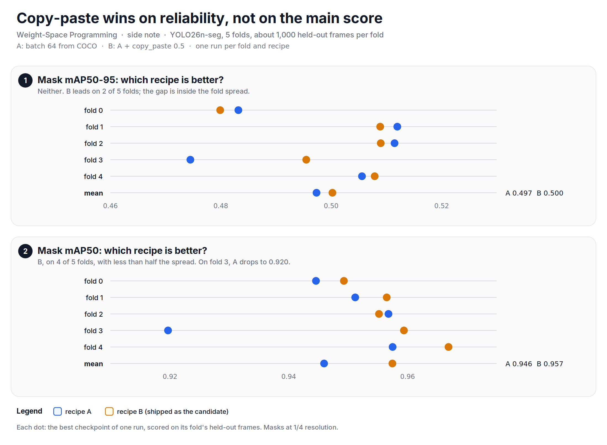

Lately, I have been trying weight-space programming on real models, and this note is a short side step. In the [first note][eel], I edited an eel detector without new training. This time I let a coding agent train new versions of the same detector, a YOLO26n-seg model, and then read the weights of what it trained.

This is not a weight-space programming experiment. Gradient training made every model in this note, and no weight edit went into the result. I keep it in the series for two reasons: the agent drove a full training study by itself, and the weight reading explains why some easy tricks fail.

The agent was Claude Code (CLI) with Opus 5.5 at medium thinking, on one AMD MI325X GPU, in Docker. I set the goal and the rules, approved the extra experiments, and I will score the result by hand. **The comparison against the production model is still pending.** No weights, frames or labels are public, so this note has no repository. The [index][index] lists all the notes of this series.

## What the agent had to do
The goal: train a nano YOLO26-seg model that can replace the production model. The rules: image size 512, all 22 classes kept, nano size, one GPU, one job at a time.

Before diving in, let's look at the traps the agent found before any useful run. Each one would have made the results wrong without an error message.

| Trap | What it means |
| --- | --- |
| The dataset validates on its training frames | the production model's 0.950 mask mAP50 on it is memorisation, so it cannot be scored on this data |
| Consecutive frames are near-duplicates | a random split leaks; frames closer than 50 frame numbers must stay in one fold |
| A fold that starts from the production weights leaks | every fold starts from COCO weights |
| `optimizer=auto` picks AdamW below 10k steps | a larger batch means fewer steps, so it can change the optimizer, not only the batch |
| `val()` ignores `retina_masks` | masks are scored at 1/4 resolution unless you score saved predictions |
| GPU kernels compile on the first steps | short timing tests on ROCm are wrong; time past the warm-up |

It means that the first job of the agent was not training. It was finding out what a fair test is.

## The training study
The agent built 5 folds of 4,986 frames, about 1,000 held-out frames per fold, and compared two recipes. Recipe A is the baseline at batch 64. Recipe B adds copy-paste augmentation at 0.5. A third recipe, batch 128, ran on fold 0 only and gave no gain.

The 11 CV jobs first ran in parallel. A server crash stopped 10 of them. The agent wrote a resume script that removes the zero bytes that the crash left in the result files, and then ran the remaining work one job at a time: 16 jobs (10 resumes, 5 experiments and 1 final run) with no failure and no idle gap. A watcher stopped the queue at its last line, or when no result file changed for 40 minutes.

*Figure: recipe A against recipe B on the 5 folds. B wins on reliability, not on the main score.*

| Recipe | Mask mAP50-95 | Mask mAP50 |
| --- | --- | --- |
| A | 0.4974 ± 0.017 | 0.9460 ± 0.0156 |
| B | 0.5002 ± 0.013 | 0.9575 ± 0.0064 |

On mask mAP50-95 the two recipes tie. B is better on mask mAP50, on 4 of 5 folds, and its spread across folds is less than half that of A. The agent picked B for that reason.

The final candidate is recipe B on all 4,986 frames. A run on all frames has no held-out data, so early stopping cannot work. The agent stopped it at epoch 150, because the 5 B folds score best on average at that epoch (0.4956 mask mAP50-95 over epochs 146 to 154). It also deleted the "best" checkpoint of that run, because that checkpoint was chosen on the training frames. The run took 2.17 hours.

## What the weights said
After the study, the agent read the weights and the activations of all runs. Each claim below gives its scope.

**The production model has lost capacity.** It has 66 dead channels and 277 batch-norm gammas below 0.01. The 11 CV runs have 0 dead channels of 10,520, and at most one gamma below 0.01 each. The production model also fires less: a mean fire rate of 0.468, against 0.564 to 0.572.

**Independent runs cannot be averaged.** Two runs from the same COCO start on the same fold (fold 0, one pair) do not share a channel basis. Their midpoint loses 0.10 mask mAP50-95, and a soup of three runs loses more.

Why does a third run make it worse? Let's say two layers compute the same features, but in another channel order. The average of the two weights mixes unrelated channels, and the activations shrink. Let's look at the code.


def collapse_demo(seed=0):
    rng = np.random.default_rng(seed)
    x = rng.standard_normal((4096, 64))
    w = rng.standard_normal((64, 64)) / 8
    w_perm = w[:, rng.permutation(64)]   # same function, other channel order
    act = lambda wt: np.maximum(x @ wt, 0.0)
    return act(w).std(), act((w + w) / 2).std(), act((w + w_perm) / 2).std()

one, aligned, unaligned = collapse_demo()
print("Aligned average keeps the scale. Is pass?", abs(aligned - one) < 1e-9)
print("Unaligned average shrinks it by more than 20 %. Is pass?", unaligned < 0.8 * one)
# std: one layer 0.581, aligned average 0.581, unaligned average 0.408
# Aligned average keeps the scale. Is pass? True
# Unaligned average shrinks it by more than 20 %. Is pass? True


The full script is available [here][script]. If the shrink is the cause, then new batch-norm statistics must repair it. They do, in part: +0.10 on the three-run soup, but only +0.01 on the two-run blend.

**A shared trunk makes averages safe, but not better.** The agent trained one 50-epoch trunk on fold 0 and forked three children from it. Every 50/50 blend of two children scores at or above its weaker endpoint, even across recipes. But the soup of the three children (0.470) stays below the best single run (0.481), and new batch-norm statistics now hurt it (0.456). On this data, a soup repairs a late decline; it does not add accuracy. This is one trunk on one fold, and the trunk runs used momentum 0.937 while the CV runs used 0.9. The fold 0 numbers in this section come from a CPU re-evaluation, so they differ from the CV table by up to 0.002.

*Figure: weight averages on fold 0. Without a shared trunk they collapse; with one they are safe, but none beats the best single run.*

**A third of the network can stay at COCO.** The deep P5 blocks (34 % of the weights) move least in training, and in a different direction in each run. Freezing them at COCO gave 0.478 against 0.481. That is one fold and one seed, the frozen run used momentum 0.937 against 0.9 for A_f0, and seed noise on fold 0 is 0.001 to 0.005, so it says "no measurable loss", not "better".

**The firing pattern shows where an image shift acts.** On one model and 80 probe frames (about 80 % of them seen in training), the agent added synthetic shifts and measured how far each block's activations move. Brightness moves only the first blocks and does not hurt the output. Noise and turbid haze move the head, and the mean eel confidence falls from 0.778 to 0.640 and 0.668. It is a label-free check for new footage, tested on synthetic shifts only.

## What I take from it
- The agent did a full training study by itself: it found the leaks, designed the folds, recovered from a crash, and stopped the final run at an epoch chosen from the folds.
- The weights explained the failures of the easy tricks: averages of independent runs mix channels that do not match.
- Nothing from the weight reading went into the candidate. The candidate is plain recipe B, and its test against the production model is still to come.

So, in short: an agent can drive a careful training study end to end, and reading the weights of what it trained tells you which shortcuts not to try.

**Reference:**
- [Sparks of Weight-Space Programming][mit], Takehi, Teoh, Zhang and Khattab, MIT CSAIL.
- [Weight-Space Programming - Editing an eel detector without new data][eel]
- [Weight-Space Programming - Index][index]

[mit]: https://rikiyat.github.io/blog/weight-space-programming
[eel]: https://github.com/mrtpk/kaizen/tree/master/learnings/20261108_eel_weight_space
[index]: https://github.com/mrtpk/kaizen/tree/master/learnings/20261112_wsp_index
[script]: https://github.com/mrtpk/kaizen/blob/master/learnings/20261114_wsp_eel_agent_training/eel_agent_training.py
